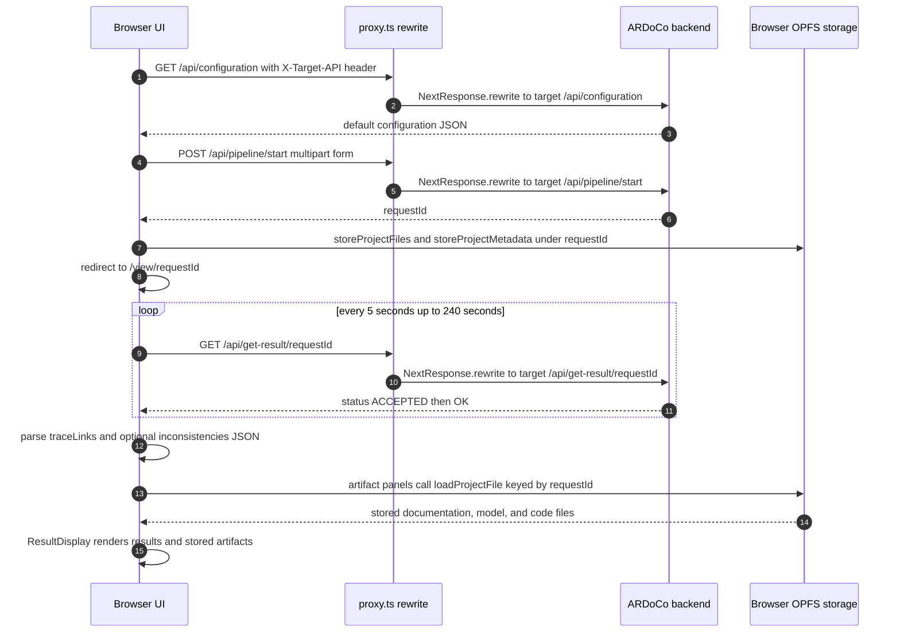
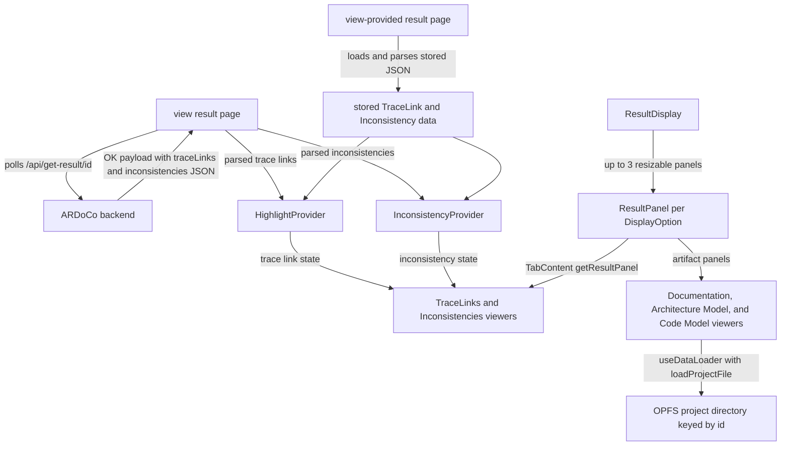

# Architecture

TraceView is a client-heavy Next.js App Router application (React 19 + TypeScript, see `package.json`). It is the browser frontend for ARDoCo trace-link recovery: users assemble a project from documentation, architecture-model, and code artifacts, submit it to an ARDoCo backend, and inspect the returned trace links and inconsistencies in a multi-panel viewer. Almost all logic runs in the browser; the Next.js server's main architectural job is rewriting `/api/*` requests onto the configured backend.

## App shell and global providers

`src/app/layout.tsx` wraps every page in `ApiAddressProvider` -> `NavigationProvider` and renders `NavBar` above a fixed, scrollable content area. It also loads `globals.css`, the Inter font, and the global metadata ("ARDoCo TraceView"). Because the providers sit above `{children}`, the backend address and the navigation guard are available to every route without per-page wiring. Nearly all components are marked `'use client'`, so changes must respect client-side rendering constraints.

`NavBar` (`src/components/NavBar.tsx`) shows the connected API address ("Connected API: …") with a pencil button that opens `EditApiAddressModal`, and links to New Project (`/new-project`), Load Project (`/load-project`), and external ARDoCo/GitHub pages. Desktop navigation is intercepted and routed through `NavigationContext.handleNavigation`, so the leave-project guard applies to nav clicks (the mobile dialog uses plain anchors).

The landing page `/` (`src/app/page.tsx`) is a client component with a hero section and an ARDoCo description; its **Start** button is a link to `/new-project`, routing users into the wizard.

## Route map

`next.config.ts` sets `pageExtensions: ["mdx", "tsx", "ts"]` and `output: 'standalone'`; the Dockerfile builds once and runs the standalone `server.js` on port 3000 (see [Operations](operations.md)). The `@/*` import alias maps to `./src/*` in `tsconfig.json`.

| Route | Source | Behavior |
| --- | --- | --- |
| `/` | `src/app/page.tsx` | Landing page; Start button routes to `/new-project`. |
| `/new-project` | `src/app/new-project/page.tsx` | Wraps `MultiStepFormNewProject` in `FormProvider` with `allowedFileTypes` set to every `FileType` **except** `TRACELINKS` and `INCONSISTENCIES`. Four-step wizard that submits to ARDoCo. |
| `/load-project` | `src/app/load-project/page.tsx` | Wraps `MultiStepFormLoadProject` in `FormProvider` with **all** file types allowed. Single-step flow that stores uploaded files (including trace-link/inconsistency JSON) locally and routes to the stored-project viewer. |
| `/view/[id]` | `src/app/view/[id]/page.tsx` | Polls the backend for a completed run, then renders the result viewer. |
| `/view-provided/[id]` | `src/app/view-provided/[id]/page.tsx` | Renders a locally stored project (from the load-project flow or a failed submission) without any backend call. |

## `/api/*` handling: middleware rewrite to ARDoCo

The repository defines **no local API route handlers**. Every `/api/*` URL the browser fetches is handled by the app-wide middleware in `src/proxy.ts` (Next.js proxy convention, matched by `config.matcher: '/api/:path*'`). `proxy()` reads the `X-Target-API` request header — supplied by the client from `ApiAddressContext` — and rewrites the request with `NextResponse.rewrite` to `` `${target.origin}/api/${path}` `` while preserving the original headers. The Next.js server therefore performs the actual cross-origin call, and the UI stays independent of the backend host as long as an address is configured.

The middleware enforces the contract before rewriting:

- missing `X-Target-API` header -> `400`
- header that is not a parseable URL -> `400`
- target protocol other than `http:`/`https:` -> `403`

Client-side call sites that rely on this rewrite:

| Caller | Request | Purpose |
| --- | --- | --- |
| `src/contexts/ApiAddressContext.tsx` | `GET /api/health` | Validate a candidate backend address before saving it. |
| `src/contexts/ProjectUploadContext.tsx` | `GET /api/configuration` | Load the default trace-link configuration for the wizard. |
| `src/util/ArdocoApi.tsx` | `POST /api/{pipeline}/start` or `POST /api/find-inconsistencies/start` | Multipart project submission. |
| `src/app/view/[id]/page.tsx` | `GET /api/get-result/{id}` | Poll for the finished result. |

The backend-side contract of these endpoints is documented in [ARDoCo backend API](integrations/ardoco-backend-api.md).

## Client state contexts

React contexts carry the cross-cutting client state (see [Project forms](architecture/project-forms.md) for the form-facing details):

- **`ApiAddressContext`** (`src/contexts/ApiAddressContext.tsx`) holds the target ARDoCo backend address. It defaults to `https://rest.ardoco.de`, hydrates from `localStorage` key `apiAddress` on mount, and `setApiAddress` normalizes the input (strips any `/api/...` suffix and trailing slash), probes it with `GET /api/health` through the middleware, and only persists and applies the address when the probe succeeds. `NavBar` displays the address (`loading` until hydrated) and the edit modal reports "Could not connect to the API at this address." on failure.
- **`ProjectUploadContext`** (`src/contexts/ProjectUploadContext.tsx`) owns the wizard form state: `projectName`, `selectedTraceLinkType`, `files`, `errors`, `traceLinkConfiguration`, and `findInconsistencies`. The `FormProvider` takes an `allowedFileTypes` prop from the route and fetches `/api/configuration` (with `X-Target-API`) whenever it mounts or `apiAddress` changes, exposing `configurationLoading`/`configurationError` and keeping the payload as both `originalTraceLinkConfiguration` and `formData.traceLinkConfiguration`. `updateFormData` automatically resets `findInconsistencies` to `false` whenever the resulting selected trace-link type is not `SAD_SAM`, mirroring the backend restriction that inconsistency detection exists only for that pipeline.
- **`NavigationContext`** (`src/contexts/NavigationContext.tsx`) tracks the currently open project id and owns the leave-project lifecycle. When `currentProjectId` is set, `handleNavigation` opens `ConfirmNavigationModal` ("Navigating away will delete the current project's data from your browser"); confirming deletes the project's OPFS directory via `deleteProjectDirectory`, clears the id, aborts the shared `AbortController` used by in-flight requests, and only then navigates. The context exposes that `AbortController` so the polling fetch on `/view/[id]` can be cancelled on leave.
- **`HighlightTracelinksContextType`** and **`HighlightInconsistencyContext`** (`src/contexts/`) coordinate cross-panel highlighting in the result viewer; see [Highlighting](architecture/highlighting.md).

## Project submission flow

`src/components/multiStepForm/MultiStepFormNewProject.tsx` orchestrates the four-step wizard — Upload Files, Project Details, Configuration, Summary — with per-step validation from `src/components/multiStepForm/FormValidation.tsx` (at least two files, a type for every file, no more than one architecture model, project name and trace-link type required). On the final step ("Calculate TraceLinks") it:

1. calls `fetchArdocoApi` from `src/util/ArdocoApi.tsx` with the form state,
2. stores the files actually submitted (`result.usedFiles`) plus metadata for all uploaded files in the browser under the returned `requestId`,
3. redirects to `/view/{encodedRequestId}?type={traceLinkType}&inconsistencies={bool}`.

`fetchArdocoApi` builds the multipart request per pipeline: `projectName`, an `additionalConfigs` JSON field (empty values filtered out), and the type-specific `inputCode` / `inputText` / `inputArchitectureModel` fields plus `inputArchitectureModelFormat` (the PCM/UML discriminant). It posts to `/api/{api_name lowercased}/start` — e.g. `/api/transarc/start` for TransArC — or to `/api/find-inconsistencies/start` when `findInconsistencies` is set, which it only permits for `SAD_SAM`. Required file combinations per pipeline are validated explicitly, a missing `requestId` in the response is rejected, and the used files are returned for local storage. The pipeline catalog itself lives in `src/components/dataTypes/TraceLinkTypes.tsx` (see [Domain model](domain.md)).

Failures are handled in the UI: an API error modal offers **Retry** or **View Files Only** — the latter stores the files locally under the `requestId` and routes to `/view-provided/{requestId}` so the artifacts remain inspectable without a backend result. A separate modal covers failures while writing to browser storage.

The `/load-project` path (`MultiStepFormLoadProject`) is simpler: it generates a `uuid` v4 storage id, stores all uploaded files and metadata locally, and redirects to `/view-provided/{id}`.

## Result lifecycle: polling vs. stored projects

`/view/[id]` owns the asynchronous backend run. Its `pollForResult` helper `GET`s `/api/get-result/{id}` (with `X-Target-API`) every 5 seconds for up to 240 seconds, using the shared `NavigationContext` `AbortController` signal: `status: "OK"` returns the payload, `"ACCEPTED"` keeps polling, any other status raises an error carrying the backend message, and the timeout raises a still-processing error. `AbortError`s are swallowed, so navigating away (which aborts the controller) ends polling silently. While waiting, a "Generating Trace-Links, please wait…" banner is shown. On completion the page parses `response.result.traceLinks` and — when the query parameter requested them and they are present — `response.result.inconsistencies`, wraps `ResultDisplay` in `HighlightProvider` and `InconsistencyProvider`, and registers the decoded project id in `NavigationContext` (cleared on unmount). The trace-link type comes from the `type` query parameter (falling back to `SAD_SAM_CODE`), and `displayOptions` are built as that type's `resultViewOptions` with `TRACELINKS` unshifted first and `INCONSISTENCIES` appended when requested. Polling errors surface in `LoadingErrorModal` with **Retry** or **View Files Only** (which renders the panels without parsed trace links).

`/view-provided/[id]` reconstructs a result purely from browser storage: `loadProjectMetaData` returns the stored file types, a stored `TRACELINKS` JSON (`traceLinkType` + `traceLinks`) and/or `INCONSISTENCIES` JSON is parsed into typed models, and `displayOptions` are derived from the stored types via `getResultViewOption`. No backend call happens on this route.

## End-to-end data flow

The non-obvious part of the flow is the split data source after submission: the backend result fetched via `/api/get-result/{id}` contains **only** trace-link (and optionally inconsistency) JSON, while the artifact panels render files that were stored in the browser's Origin Private File System (OPFS) at submission time, keyed by the same request id. `ClientFileStorage` (`src/util/ClientFileStorage.tsx`) creates a per-project directory under `navigator.storage.getDirectory()`, writes files under canonical names — both architecture-model variants share the stored name `Architecture Model`, so the panel loader resolves the actual format through `project.meta.json` — and can delete a project directory recursively. The full storage contract is in [Client-side project storage](architecture/client-storage.md).

*Request and data flow: the browser targets `/api/*`, the middleware in `src/proxy.ts` rewrites each call onto the ARDoCo backend named by `X-Target-API`, submission stores artifacts in OPFS, polling delivers only the result JSON, and the panels combine parsed results with OPFS-stored artifacts.*

The two result routes feed the same viewer from different sources:

*Result data sourcing: `/view/[id]` parses the polled backend JSON into the highlight contexts, `/view-provided/[id]` parses the same shapes from OPFS, and artifact viewers always load their inputs from the OPFS project directory.*

## Rendering model

The result area is a multi-panel viewer built on `react-resizable-panels`:

- `src/components/traceLinksResultViewer/ResultDisplay.tsx` renders up to three panels (`displayOptions.slice(0, 3)`) inside a resizable `Group` with separators; only the first and last panels are collapsible.
- Each `ResultPanel` has a sticky select to switch its view among all `displayOptions` and a button that opens `FullScreenResultDialog`, a tabbed fullscreen dialog covering every available view. `SearchResultMessage` shows a transient toast summarizing how many trace links / inconsistencies the last click matched.
- `TabContent.getResultPanel` maps each `DisplayOption` to one of five viewers under `views/` — `documentation`, `architectureModel`, `codeModel`, `tracelinks`, and `inconsistencies`. Each view owns its own `parser/`, `dataModel/`, and `viewer/` subfolders.
- The artifact viewers fetch their input with the `useDataLoader` hook plus `loadProjectFile` and parse it into typed view models (documentation sentences, PCM/UML architecture components and edges, ACM code units); the tracelinks and inconsistencies viewers render the shared highlight-context state instead.

Parsers normalize raw payloads before rendering — for example, `TraceLinkParser` adds 1 to backend sentence numbers so the UI can display 1-based sentences. Panel-level changes should be tested for resize/collapse behavior; see [Result viewer](architecture/result-viewer.md).

## Conventions and change entry points

- Most components are `'use client'`; keep client-side rendering constraints in mind.
- The `@/*` import alias maps to `./src/*` (`tsconfig.json`).
- File-type discriminants live in `src/components/dataTypes/` and drive validation, request building, and panel selection.
- `react-resizable-panels` is central to the result layout.

Where to start when changing the architecture:

- Routing or page-level behavior: `src/app/` and `next.config.ts`.
- Upload state or form rules: `src/contexts/ProjectUploadContext.tsx` and `src/components/multiStepForm/`.
- `/api/*` behavior: `src/proxy.ts` (rewrite target, header validation) and the call sites above.
- Backend request or polling logic: `src/util/ArdocoApi.tsx` and `src/app/view/[id]/page.tsx`.
- Local persistence: `src/util/ClientFileStorage.tsx`.
- Result visualization: `src/components/traceLinksResultViewer/`.

## Subsystem index

- [Result viewer](architecture/result-viewer.md) — multi-panel layout, viewers, and fullscreen mode.
- [Highlighting](architecture/highlighting.md) — cross-panel highlight state and interaction model.
- [Project forms](architecture/project-forms.md) — wizard steps, validation, and configuration editing.
- [Client-side project storage](architecture/client-storage.md) — the OPFS contract keyed by request id.
- [ARDoCo backend API](integrations/ardoco-backend-api.md) — the endpoints reached through the `/api/*` rewrite.
