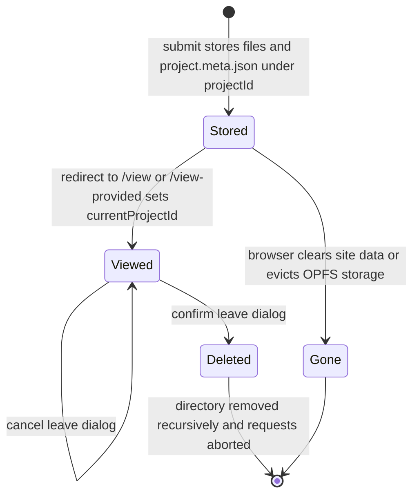
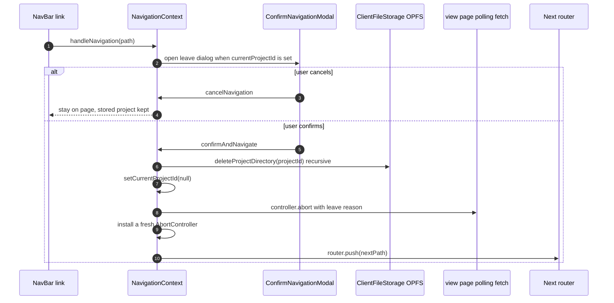

# Client-side project storage

TraceView keeps every project artifact — documentation, architecture model, code model, and (for loaded projects) trace-link and inconsistency JSON — in the browser's Origin Private File System (OPFS). There is no server-side artifact store: the ARDoCo backend receives the files once per submission and later returns only result JSON, while the result viewer always re-reads the artifacts from local browser storage. This page documents the storage module (`src/util/ClientFileStorage.tsx`), the two form flows that write into it, the view pages that read from it, and the `NavigationContext` guard that deletes a stored project when the user leaves. See [Architecture](../architecture.md) for how this fits into the overall client architecture and [Project forms](project-forms.md) for the wizard steps themselves.

## Storage location and layout

All storage functions start from the OPFS root via `navigator.storage.getDirectory()` and resolve one sub-directory per project with `getDirectoryHandle(projectId, {create: true})`. The project id is the storage key:

- the **new-project wizard** keys the directory by the `requestId` returned by the backend start call,
- the **load-project flow** keys it by a locally generated `uuidv4`.

Ids are `encodeURIComponent`-encoded when placed into routes and `decodeURIComponent`-decoded again in the view pages, so the decoded route id always matches the directory name in OPFS.

Within a project directory, each artifact is stored under a canonical name produced by `getStoredFileName`, plus one metadata file:

```text
OPFS root/
└── <projectId>/
    ├── project.meta.json
    ├── Documentation
    ├── Architecture Model      (shared name for PCM and UML)
    ├── Code Model
    ├── TraceLinks              (only present for loaded projects)
    └── Inconsistencies         (only present for loaded projects)
```

`project.meta.json` is a JSON array with one entry per uploaded file, written with pretty-printing:

```json
[
  {
    "fileType": "PCM",
    "storedFileName": "Architecture Model",
    "originalName": "example.repository"
  },
  {
    "fileType": "Documentation",
    "storedFileName": "Documentation",
    "originalName": "docs.txt"
  }
]
```

### Stored-name rule

`getStoredFileName` maps a `FileType` to the on-disk name:

| `FileType` value | Stored file name |
| --- | --- |
| `PCM` / `UML` | `Architecture Model` (both share one name) |
| `Documentation` | `Documentation` |
| `Code Model` | `Code Model` |
| `TraceLinks` | `TraceLinks` |
| `Inconsistencies` | `Inconsistencies` |

The shared `Architecture Model` name is the central convention of this subsystem: because the file name alone no longer reveals whether a stored model is PCM or UML, `project.meta.json` is the only record of the actual format and of the original file names. The form validators cap projects at one architecture model (PCM or UML combined), which is what prevents two models from colliding on the shared name — the storage layer itself would silently overwrite, since a second write to the same handle replaces the first file.

Two invariants follow from the write design:

- **Writes are not transactional.** `storeProjectFiles` and `storeProjectMetadata` are two independent calls; a failure between them can leave files without metadata, and a failure inside `storeProjectFiles` can leave a partial set of files.
- **Metadata and file bodies can diverge in the new-project flow.** The wizard stores file bodies only for `result.usedFiles` (the files actually included in the multipart request) but writes metadata for all of `formData.files`, so metadata can list an artifact whose body was never stored.

## The `ClientFileStorage` API

`src/util/ClientFileStorage.tsx` exposes five async functions, all guarded against server execution:

| Function | Responsibility | Error behavior |
| --- | --- | --- |
| `storeProjectFiles(projectId, uploadedFiles)` | Creates the project directory and writes each file under `getStoredFileName(file.fileType)` via `createWritable()` | Throws on SSR; storage errors propagate to the caller |
| `storeProjectMetadata(projectId, uploadedFiles)` | Writes `project.meta.json` with `fileType`, `storedFileName`, and `originalName` per file | Throws on SSR; storage errors propagate to the caller |
| `loadProjectFile(projectId, fallbackType)` | Resolves the actual stored type/name from metadata, reads the file text, returns `{content, fileType}` | `NotFoundError` → `null`; other errors rethrow; SSR throws |
| `loadProjectMetaData(projectId)` | Reads `project.meta.json` and returns the stored types as `FileType[]` via `convertStringToFileType` | Errors (including a missing directory) propagate; SSR throws |
| `deleteProjectDirectory(projectId)` | `removeEntry(projectId, {recursive: true})` on the OPFS root | SSR is a warn-and-return no-op; all failures are logged and swallowed |

### Read semantics of `loadProjectFile`

`loadProjectFile` never trusts the caller's type blindly. It:

1. computes the candidate stored name from the `fallbackType` argument,
2. tries to read `project.meta.json` and looks up the entry whose `storedFileName` matches; if found, the actual type comes from the metadata's `fileType` (via `convertStringToFileType`) and the file name is re-derived from that type,
3. falls back to the caller's `fallbackType` and its stored name when metadata is missing or unreadable (logged as a warning),
4. reads the file text and returns `{content, fileType}`, or `null` when the file lookup raises `NotFoundError`; any other error is rethrown.

Two consequences matter for callers:

- The directory lookup in `loadProjectFile` uses `create: true`, so probing an unknown project id creates an empty OPFS directory as a side effect before the file lookup fails and returns `null`.
- `convertStringToFileType` maps exact `FileType` values to themselves, defaults the shared name `"Architecture Model"` to `UML`, and maps anything unknown to `FileType.NONE`. Combined with the metadata fallback, a stored architecture model whose metadata entry is lost is read back as UML.

The architecture-model viewer depends on this resolution: it calls `loadProjectFile` with `ARCHITECTURE_MODEL_UML` as the fallback and then dispatches to `parsePCM` or `parseUMLModel` based on the returned `fileType` — so a stored PCM model renders correctly only while its metadata entry survives.

### Error asymmetry between the two readers

`loadProjectFile` converts `NotFoundError` into `null` so viewers can render a "not found" fallback, but `loadProjectMetaData` performs no error handling at all: a missing project directory or unreadable meta file rejects its promise. The `/view-provided/[id]` page calls `loadProjectMetaData` outside its `try`/`catch` (which only wraps the trace-link and inconsistency parsing), so opening a stale or nonexistent stored-project URL leaves the page in its loading state instead of showing the error banner.

## Write paths: how projects get stored

### New-project wizard (`MultiStepFormNewProject.handleSubmit`)

On the final wizard step ("Calculate TraceLinks"), after `fetchArdocoApi` succeeds:

1. `storeProjectFiles(jsonResult.requestId, result.usedFiles)` stores the files that were actually submitted to the backend,
2. `storeProjectMetadata(jsonResult.requestId, formData.files)` writes metadata for every uploaded file,
3. the wizard redirects to `/view/{encodedRequestId}?type={traceLinkType}&inconsistencies={bool}`.

Failures are surfaced distinctly: a backend error opens the `LoadingErrorModal`, and a storage error opens the single-button `ErrorModalFileUpload` and aborts the redirect. The API-error modal's **View Files Only** fallback re-runs the whole `handleSubmit` — retrying the backend call and the storage writes — and, when it succeeds, routes to `/view-provided/{requestId}` instead of `/view`, leaving the artifacts inspectable without a backend result.

### Load-project flow (`MultiStepFormLoadProject.handleSubmit`)

The single-step load-project flow generates `storageId = uuidv4()`, stores **all** uploaded files (the `/load-project` route allows every `FileType`, including `TraceLinks` and `Inconsistencies` JSON) plus metadata, and redirects to `/view-provided/{storageId}`. Storage errors here are only logged: the flow still returns the storage id and navigates, so a partially stored project can reach the viewer.

One validation gap is visible at the storage layer: the new-project validator rejects files whose type was never selected (`FileType.NONE`), but `validateExistingProject` for load-project does not. An untyped file in the load flow is therefore stored under the literal `NONE` value `"Select file type"`, comes back from `loadProjectMetaData` as `FileType.NONE`, and has no `getResultViewOption` panel mapping on `/view-provided`.

## Read paths: how the viewer loads stored data

`/view-provided/[id]` reconstructs a result purely from storage, with no backend call:

1. `loadProjectMetaData(id)` returns the stored `FileType[]`,
2. the types drive the viewer panels through `getResultViewOption` (Documentation, Architecture Model, Code Model, TraceLinks, Inconsistencies),
3. a stored `TraceLinks` JSON (`traceLinkType` + `traceLinks`) and/or `Inconsistencies` JSON is loaded with `loadProjectFile` and parsed into the typed viewer models.

An id-handling quirk: the metadata call uses the raw route param `id` while the file loads use the decoded `uriDecodedId`. For ids that survive URI encoding unchanged the two are the same string; an id containing characters that get percent-encoded would look up metadata and file bodies in different OPFS directories.

The three artifact viewers — `DocumentationViewer`, `ArchitectureModelViewer`, and `CodeModelViewer` — load their inputs through the `useDataLoader` hook plus `loadProjectFile`, keyed by the route id. They run identically on `/view/[id]` and `/view-provided/[id]`, which means the panels of a backend-polled result also read the artifacts from the OPFS directory that the wizard stored under the same `requestId`. When a file is missing (`loadProjectFile` → `null`), the viewers render their empty/raw-content fallbacks instead of panel content.

## Navigation guard and delete-on-leave

`NavigationProvider` wraps every page in `src/app/layout.tsx` and owns three pieces of state: the currently open `currentProjectId`, the pending `nextPath`, and a shared `AbortController`. Its `ConfirmNavigationModal` is rendered globally, next to the page content.

The flow:

- `handleNavigation(path)` pushes the route directly when no project is active; when `currentProjectId` is set it instead opens `ConfirmNavigationModal` ("Navigating away will delete the current project's data from your browser.") with **Cancel** and **Leave Page** buttons.
- Confirming runs `confirmAndNavigate`, which deletes the project's OPFS directory recursively via `deleteProjectDirectory`, clears `currentProjectId`, aborts in-flight requests through the shared controller, and only then calls `router.push(nextPath)`.
- `abortController()` aborts with the reason `"User is leaving the page or navigating away."` and immediately installs a fresh `AbortController`, so later requests get a usable signal.
- Cancelling only closes the modal and drops `nextPath`; stored data is untouched.

Because `deleteProjectDirectory` swallows and only logs failures, a confirmed navigation proceeds to the new route even if the directory could not be removed — deletion is best-effort, not a precondition of navigation.

### Abort wiring

The shared controller's signal is consumed by `/view/[id]`: its `pollForResult` loop `GET`s `/api/get-result/{id}` with that signal every 5 seconds for up to 240 seconds, and `fetchResult` swallows `AbortError`, so a confirmed leave ends polling silently. The modal's **Retry** path, however, creates its own local `AbortController`, so a retried poll is no longer cancelled by a later confirmed leave.

### Project-id registration asymmetry

Both result pages register their decoded id via `setCurrentProjectId` on mount, but they differ on cleanup:

- `/view/[id]` clears the id in its unmount cleanup, disarming the guard once the page is left.
- `/view-provided/[id]` registers the id with the cleanup commented out, so the guard stays armed after the viewer is gone — a later guarded navigation will still prompt for, and delete, that stored project.

### Coverage boundaries of the guard

Only callers of `handleNavigation` are guarded: the desktop navigation links and the ARDoCo logo route through it (`NavBar` intercepts and prevents the default anchor behavior). The mobile menu renders plain anchors and browser back/forward navigation bypasses `handleNavigation` entirely, so those paths leave a stored project in place without prompting.

## Project lifecycle



*Lifecycle of a locally stored project: either form stores the artifacts under a project id, the viewer registers the id in `NavigationContext`, and the project leaves existence either by a confirmed navigation (explicit recursive delete) or by the browser discarding the storage.*

Paths that bypass the guard (mobile menu links, browser back, tab close, reload) leave the project in the `Stored` state; it then survives until a later confirmed navigation deletes it or the browser discards the data.

The confirmed-navigation interaction across components:



*Confirmed navigation: the guard deletes the OPFS project directory, disarms itself, aborts in-flight backend requests, and then performs the route change; cancelling leaves everything untouched.*

## Failure semantics and operational implications

- **Local artifacts are ephemeral by design.** The backend returns only trace-link and inconsistency JSON from `/api/get-result/{id}`; it never re-serves the uploaded artifact files. Clearing browser storage (site data) or confirming the leave dialog therefore permanently removes the locally stored artifacts — there is no way to re-fetch them for the viewer.
- **Stale ids fail asymmetrically.** `loadProjectFile` turns a missing file into `null` (viewers show fallbacks), while `loadProjectMetaData` rejects; because `/view-provided` calls it outside its error handling, a deep link to an expired stored project id stalls the page in its loading state.
- **Partial storage is possible.** The two-step, non-transactional write can leave files without metadata (new-project) or a partially stored project that still navigates to the viewer (load-project).
- **No dedicated tests.** The repository has no unit-test script or storage-specific test suite; CI verification for this subsystem is the `npm run build` gate, so changes to the storage contract need manual browser verification.

## Related pages

- [Architecture](../architecture.md) — overall routing, contexts, and the end-to-end data flow around this storage layer.
- [Project forms](project-forms.md) — the wizard steps, validation, and configuration editing that feed `handleSubmit`.
- [Result viewer](result-viewer.md) — the panels that consume `loadProjectFile` and the parsed result JSON.
- [Domain model](../domain.md) — artifact types, pipeline combinations, and project identity.
- [Workflows](../workflows.md) — the user journeys that create, view, and abandon stored projects.
- [Operations](../operations.md) — build, deployment, and the note that clearing browser storage affects the provided-project flow.
