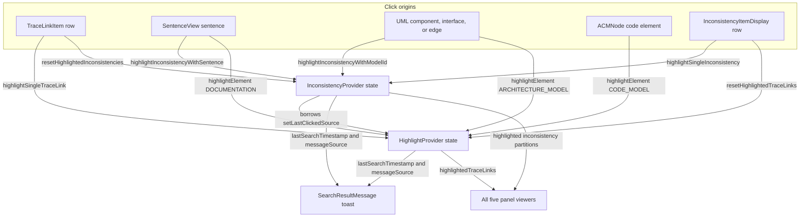
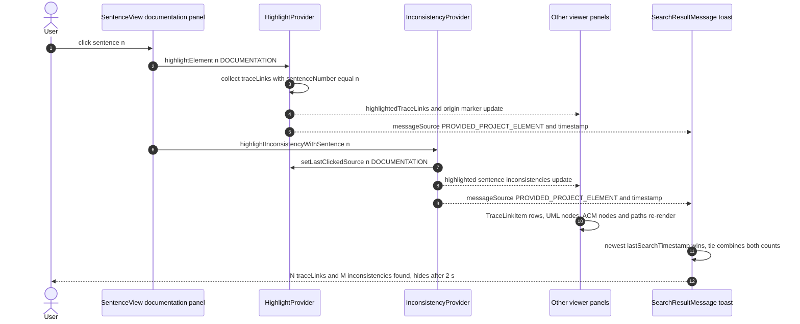

# Cross-panel highlighting

The result viewer's central interaction is **cross-panel highlighting**: clicking a sentence, a model element, a code element, a trace link, or an inconsistency highlights everything related to that selection in every other panel. The engine is deliberately small — two React contexts own the highlight state, a shared vocabulary of `DisplayOption` and `MessageSource` values ties the panels together, and a toast summarizes each selection — while the five view modules under `src/components/traceLinksResultViewer/views/` (`documentation`, `architectureModel`, `codeModel`, `tracelinks`, `inconsistencies`) only read state and emit clicks. The panel layout itself is covered in [Result viewer](result-viewer.md); how the contexts get their data is covered in [Architecture](../architecture.md).

## Ownership: two contexts, one selection-origin marker

| Context | File | Owns | Also exposes |
| --- | --- | --- | --- |
| `HighlightProvider` | `src/contexts/HighlightTracelinksContextType.tsx` | `highlightedTraceLinks`, `lastSearchTimestamp`, `messageSource`, `lastClickedSource` | pass-through `traceLinks`, `traceLinkType`, `loading` |
| `InconsistencyProvider` | `src/contexts/HighlightInconsistencyContext.tsx` | `highlightedInconsistencies` (plus derived sentence/model partitions), its own `lastSearchTimestamp`, `messageSource` | pass-through `inconsistencies`, `loading` |

`lastClickedSource` — the visual *selection origin* — is owned **only** by `HighlightProvider`. `InconsistencyProvider` borrows `setLastClickedSource` from the trace-link context (`useHighlightContext()` inside its provider body), which is why the providers must be nested `HighlightProvider → InconsistencyProvider`: the inconsistency context is a *consumer* of part of the trace-link context's state, not a sibling.

`DisplayOption` (`src/components/dataTypes/DisplayOption.tsx`) is the panel vocabulary both contexts speak: `TRACELINKS`, `CODE_MODEL`, `ARCHITECTURE_MODEL`, `DOCUMENTATION`, `INCONSISTENCIES`. Every highlight function and every origin marker is tagged with one of these values, so a marker written by one panel can only be claimed by the panel whose `DisplayOption` matches.

## Trace-link matching semantics (`HighlightProvider`)

`highlightElement(id, type)` is the element-click entry point. It scans `traceLinks` and matches by the identifier appropriate to the clicked panel:

| `type` | Trace link field matched |
| --- | --- |
| `DOCUMENTATION` | `traceLink.sentenceNumber` (guarded by truthiness of `sentenceNumber`) |
| `ARCHITECTURE_MODEL` | `traceLink.modelElementId` |
| `CODE_MODEL` | `traceLink.codeElementId` |

Comparisons use loose equality (`==`), so the `id` argument may be a number (sentence identifiers) or a string (model/code element ids) interchangeably. On any non-null call the provider sets `highlightedTraceLinks` to the matches — even when that is an empty array — and additionally stamps `lastSearchTimestamp = Date.now()`, sets `messageSource = PROVIDED_PROJECT_ELEMENT`, and records `{id, type}` as `lastClickedSource`. A click that matches nothing therefore still produces feedback (the toast reports "no traceLinks found.") rather than silence.

`highlightSingleTraceLink(traceLink)` is the trace-link row entry point: it highlights exactly that link, sets `messageSource = TRACELINK`, stamps the timestamp, and records `{id: traceLink.id, type: DisplayOption.TRACELINKS}` as the origin. `resetHighlightedTraceLinks()` clears the highlight set, resets `messageSource` to `NONE`, **and clears `lastClickedSource`**.

Two guards shape the lifecycle:

- **Empty-collection no-op.** All three mutators return immediately when `traceLinks` is empty, so a viewer rendered without parsed results (e.g. the "View Files Only" fallback) cannot create highlight state at all.
- **Null-id early return.** `highlightElement(null, type)` clears the highlight set and returns *before* touching the timestamp, message source, or origin marker — clearing via a null id is a quiet reset that does not count as a new search.

## Inconsistency matching semantics (`InconsistencyProvider`)

`InconsistencyProvider` partitions its `inconsistencies` prop by type on every render — no memoization: `sentenceInconsistencies` (`TextEntityAbsentFromModel`, keyed by `sentenceNumber`) and `modelInconsistencies` (`ModelEntityAbsentFromText`, keyed by `modelElementId`), plus the same two partitions computed over `highlightedInconsistencies` so panels can check "is *my kind* of inconsistency highlighted?" independently.

Three mutators, all no-ops when `inconsistencies` is empty:

- `highlightInconsistencyWithSentence(sentence)` filters `TextEntityAbsentFromModel` entries by `sentenceNumber`; `highlightInconsistencyWithModelId(modelElementId)` filters `ModelEntityAbsentFromText` entries by `modelElementId`. Both set `messageSource = PROVIDED_PROJECT_ELEMENT`, stamp the timestamp, and delegate `setLastClickedSource(...)` to the trace-link context — with `DOCUMENTATION` / `ARCHITECTURE_MODEL` respectively as the origin type. Because `filter` always returns an array, the `if (inconsistency)` guard never fails; a miss silently assigns an empty highlight set (the embedded `console.warn` branch is unreachable), which the toast then reports as "no inconsistencies found."
- `highlightSingleInconsistency(inconsistency)` is the inconsistency-row entry point: one item, `messageSource = INCONSISTENCY`, origin `{id: inconsistency.id, type: INCONSISTENCIES}`.
- `resetHighlightedInconsistencies()` clears the highlight set and resets `messageSource` to `NONE`, but — unlike its trace-link counterpart — leaves `lastClickedSource` untouched, so the visual selection origin survives an inconsistency reset.

## MessageSource and the selection-origin marker

`MessageSource` (`src/components/dataTypes/MessageSource.tsx`) classifies *what triggered* the latest highlight and drives the shape of the toast message:

| Value | Meaning | Set by |
| --- | --- | --- |
| `TRACELINK` | a trace-link item was clicked | `highlightSingleTraceLink` |
| `INCONSISTENCY` | an inconsistency item was clicked | `highlightSingleInconsistency` |
| `PROVIDED_PROJECT_ELEMENT` | an element inside a panel (sentence, model element, code element) was clicked | `highlightElement`, `highlightInconsistencyWithSentence`, `highlightInconsistencyWithModelId` |
| `NONE` | initial state or after a reset | both `reset*` functions |

`lastClickedSource` is the cross-panel **selection-origin marker**: each clickable item compares `lastClickedSource.type` against its own `DisplayOption` and `lastClickedSource.id` against its own identifier, and renders a distinctive border/shadow/dash style when both match. The ids being compared are the model classes' composite identifiers — `TraceLink.id` is `` `${modelElementId}-${codeElementId}-${sentenceNumber}` `` and `Inconsistency.id` embeds type, reason, and the sentence number or model element id. Because the marker lives in the trace-link context but is written by both, the reset asymmetry matters in practice: `resetHighlightedTraceLinks` erases the origin marker, `resetHighlightedInconsistencies` does not.

## Toast arbitration (`SearchResultMessage`)

`SearchResultMessage` (`src/components/traceLinksResultViewer/SearchResultMessage.tsx`) is rendered once by `ResultDisplay`, outside the panels, and reads *both* contexts' `lastSearchTimestamp` and `messageSource`. Arbitration is purely by recency:

```ts
traceLinkTimestamp > inconsistencyTimestamp   → trace-link source wins
inconsistencyTimestamp > traceLinkTimestamp   → inconsistency source wins
tie + traceLinkTimestamp > 0                  → combined view (PROVIDED_PROJECT_ELEMENT)
tie + both zero                               → NONE (nothing to show)
```

The tie branch is not a corner case: element clicks call `highlightElement` and the matching inconsistency highlight synchronously in one handler, so both timestamps usually land in the same millisecond — the tie-break is exactly what turns such clicks into a combined message.

For `PROVIDED_PROJECT_ELEMENT` sources the toast composes one message from **both** counts — "N traceLinks and M inconsistencies found." — including only the counts whose panels are actually in `displayOptions`. For `TRACELINK` / `INCONSISTENCY` sources only the respective count is shown, and only when the `TRACELINKS` / `INCONSISTENCIES` panel is displayed at all. Zero counts render as "no traceLinks" / "no inconsistencies", which is how a click that matched nothing still produces visible feedback.

The toast auto-hides 2 seconds after the latest trigger (`setTimeout`), and each new message restarts the blink animation by removing the `animate-blink` class, forcing a reflow with `void el.offsetWidth`, and re-adding it inside `requestAnimationFrame` — otherwise a CSS animation already in its end state would not replay on repeated triggers. The `animate-blink` keyframes in `src/app/globals.css` are a 0.01 s opacity flash, so the visible effect is a short attention pulse rather than a continuous blink. Message segments are color-coded with the same tokens the panels use (`text-highlight-tracelink-text` / `text-highlight-inconsistency-text`), and the toast itself is a fixed, bottom-centered overlay.

## Click origins and propagation rules

Clicks originate in five kinds of place and follow two distinct propagation rules:

| Origin | Handler calls | Resets the other engine? |
| --- | --- | --- |
| `TraceLinkItem` (tracelinks panel) | `resetHighlightedInconsistencies()` → `highlightSingleTraceLink(link)` | yes |
| `InconsistencyItemDisplay` (inconsistencies panel) | `resetHighlightedTraceLinks()` → `highlightSingleInconsistency(inc)` | yes |
| `SentenceView` (documentation panel) | `highlightElement(id, DOCUMENTATION)` + `highlightInconsistencyWithSentence(id)` | no — both run |
| `UMLComponentNode`, `UMLInterface`, `UMLEdge` lollipops (architecture panel) | `highlightElement(id, ARCHITECTURE_MODEL)` + `highlightInconsistencyWithModelId(id)` | no — both run |
| `ACMNode` (code panel, plain click) | `highlightElement(id, CODE_MODEL)` | no — trace links only |

The rule is: **list-item selections are mutually exclusive** (selecting a trace link clears inconsistency highlights and vice versa), while **element selections run both engines in parallel** with the same identifier, producing simultaneous trace-link and inconsistency highlights. The code panel has no inconsistency integration at all — consistent with the domain rule that inconsistency detection only exists for the SAD-SAM (documentation + architecture model) combination.



*Click propagation topology: list items are exclusive (each resets the other engine first), element clicks drive both contexts with the same id, and both contexts feed the toast plus every panel viewer.*



*One click, all panels: a sentence click updates both contexts synchronously, every panel re-derives its highlights from the shared state, and the toast reports the combined result.*

## How each panel consumes highlights

- **Tracelinks panel** — `TraceLinkItem` highlights rows contained in `highlightedTraceLinks` (`bg-highlight-tracelink`) and draws a 2 px colored border when it is the selection origin.
- **Documentation panel** — `SentenceView` checks both engines: a sentence is trace-link-highlighted when any highlighted link has its `sentenceNumber`, inconsistency-highlighted when a highlighted `TextEntityAbsentFromModel` entry matches. When both apply, the row renders a horizontal gradient from the trace-link color to the inconsistency color. A sentence that is the selection origin but matched nothing still gets a neutral `highlight-source` border.
- **Architecture panel** — `UMLComponentNode` highlights components whose `modelElementId` is referenced by a highlighted trace link or model inconsistency, painting a left-to-right gradient between the two highlight colors and a 3 px origin border. `UMLInterface` labels and the `UMLEdge` lollipops that carry an interface id (the merged pass-through virtual edge and `uml:InterfaceRealization` realizations; the `uml:Usage` lollipop is hover-only) share the same click handlers and highlight-color logic.
- **Code panel** — `ACMNode` enlarges and recolors its circle for highlighted nodes; plain clicks highlight, **Ctrl+Click toggles collapse/expand instead of highlighting** (as its panel instructions state). `ACMViewer` additionally highlights the *ancestor edge paths* of every matched code element, computed against a separately retained fully expanded copy of the code tree (`copyExpandedTree`), and an effect auto-expands the collapsed ancestors of matched nodes whenever `highlightedTraceLinks` changes — so a match inside a collapsed subtree becomes visible.
- **Inconsistencies panel** — `InconsistencyItemDisplay` highlights rows contained in `highlightedInconsistencies` and marks the selection origin with a colored border.

### TracelinkViewer sorting interacts with highlighting

`TracelinkViewer` owns a local `sortedTraceLinks` state and a `handleSortChange` callback. Two pieces interact with the highlight engine:

- The **"Highlights" toggle** (`prioritizeHighlights`): when enabled, `handleSortChange` partitions the sorted list so every link in `highlightedTraceLinks` leads, followed by the non-highlighted ones. Because `handleSortChange` depends on `highlightedTraceLinks` (and on the toggle state) and a re-sort effect re-runs whenever the callback's identity changes, *every highlight change re-orders the list* while prioritization is on — highlights float to the top as they appear and disappear.
- The sort options themselves are filtered by trace-link type: the dimension the pipeline does not span is hidden (SAD_SAM hides "Code", SAD_CODE hides "Model", SAM_CODE hides "Sentence"), and a change of the underlying `traceLinks` array resets both the list and the sort selection to the "Sort By" sentinel.

## Wiring and lifecycle

Both result routes mount the identical provider tree around `ResultDisplay`:

- `/view/[id]` wraps `ResultDisplay` in `HighlightProvider(traceLinks, traceLinkType, loading)` with `InconsistencyProvider(inconsistencies, loading)` nested inside. `displayOptions` are the trace-link type's `resultViewOptions` with `TRACELINKS` unshifted first and `INCONSISTENCIES` appended when the query parameter requested them.
- `/view-provided/[id]` builds the same tree from locally stored data; its `displayOptions` are derived from the stored file types via `getResultViewOption`.

`ResultDisplay` renders up to three resizable panels (the first three `displayOptions`), a fullscreen tabbed dialog for all views, and the `SearchResultMessage` toast — all inside the provider tree, so a click in any panel instance (docked or fullscreen) updates the same shared highlight state. If results are absent — the "View Files Only" fallback with no parsed trace links, or no parsed inconsistencies — the empty-collection guards reduce every mutator to a no-op and the highlight engine stays inert.

## Invariants and cautions

- **Loose equality everywhere.** Matching and origin comparisons rely on `==`/`===` mixing: sentence ids are numbers, element ids are strings, and `lastClickedSource.id` is typed `string | number | null`. Changing id types on one side silently breaks matching on the other.
- **Origin-marker asymmetry.** Only `resetHighlightedTraceLinks` clears `lastClickedSource`. Code that clears inconsistency highlights expecting the origin border to disappear will not get that effect.
- **Zero-match clicks are visible.** Both engines publish timestamps and message sources even when nothing matched, so the toast always reports "no … found" — do not "optimize" these state writes away.
- **UML interface/edge inconsistency check is id-based.** `UMLInterface` and `UMLEdge` test `inconsistency.id === interfaceId`, but `Inconsistency.id` is a `type-reason-…` composite — unlike `UMLComponentNode`, which compares `modelElementId`. Interfaces and edges therefore generally do *not* show the inconsistency color even when a matching model inconsistency exists; fix the comparison field if interface-level inconsistency highlighting is needed.
- **Non-memoized partitions.** `InconsistencyProvider` recomputes its four partitions on every render; large inconsistency lists multiply filter passes across every consumer re-render.
- **List-item clicks reset before they highlight.** Each row click clears the other engine first and then sets its own highlight, so after a trace-link or inconsistency click the two engines are never both active.

## Related pages

- [Architecture](../architecture.md) — where the highlight contexts sit in the app and how both result routes feed them.
- [Result viewer](result-viewer.md) — panel layout, fullscreen dialog, and viewer module structure.
- [Domain model](../domain.md) — trace-link pipelines and the SAD-SAM restriction behind inconsistency highlighting.
- [Workflows](../workflows.md) — the user journey that ends in the multi-panel result exploration described here.
