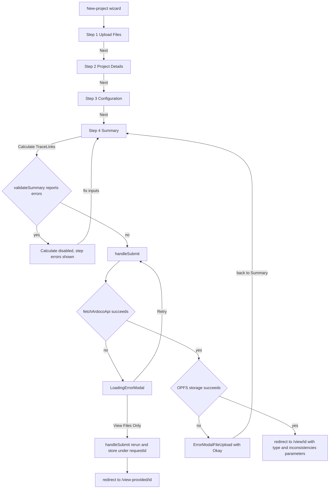
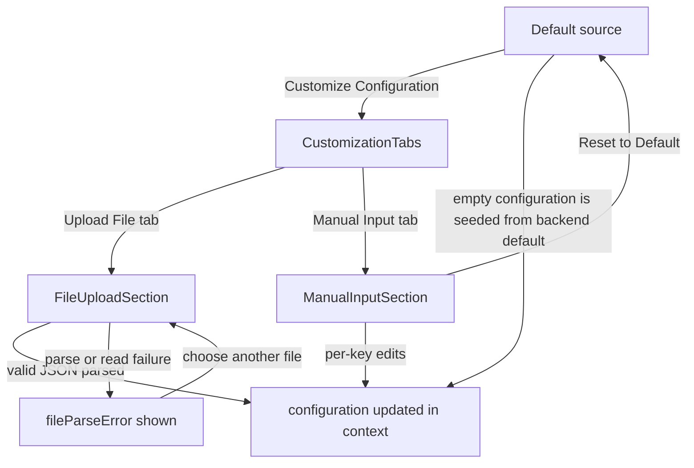

# Project forms and wizard

TraceView's data entry lives in the `multiStepForm` subsystem. Two route-level flows share one toolkit: the **new-project wizard** (`/new-project`, `MultiStepFormNewProject`) walks through Upload Files, Project Details, Configuration, and Summary before submitting the project to an ARDoCo backend, and the **load-project form** (`/load-project`, `MultiStepFormLoadProject`) accepts an existing project — including pre-computed trace-link or inconsistency JSON — in a single step and stores it purely in the browser. Both forms read and write the same `ProjectUploadContext` state, validate through `FormValidation`, render through `FormLayout` and the `Stepper` progress bar, and collect files through the same drag-and-drop widgets. [Architecture](../architecture.md) places the subsystem in the overall client, [Client-side project storage](client-storage.md) describes where submissions are persisted, the endpoints called here are specified in [ARDoCo backend API](../integrations/ardoco-backend-api.md), and the pipeline catalog is covered in [Domain model](../domain.md).

## Routes, allowed file types, and the shared form context

The two form routes differ only in how they parameterize `FormProvider` (`src/contexts/ProjectUploadContext.tsx`):

- `/new-project` (`src/app/new-project/page.tsx`) mounts `MultiStepFormNewProject` with `allowedFileTypes` set to every `FileType` **except** `TRACELINKS` and `INCONSISTENCIES` — a new submission cannot include result files.
- `/load-project` (`src/app/load-project/page.tsx`) mounts `MultiStepFormLoadProject` with **all** `FileType` values, because loading an existing project requires the trace-link and inconsistency JSON.

The provider owns the `FormData` record — `projectName`, `selectedTraceLinkType`, `files` (an `UploadedFile` list pairing each `File` with a `FileType`), `errors`, `traceLinkConfiguration`, and `findInconsistencies` — plus `configurationLoading`, `configurationError`, `originalTraceLinkConfiguration`, and the route-provided `allowedFileTypes`. `updateFormData` merges partial updates and enforces one invariant on every write: unless the resulting `selectedTraceLinkType` is `SAD_SAM`, `findInconsistencies` is reset to `false`.

On mount — and again whenever `apiAddress` changes — the provider fetches `GET /api/configuration` with the `X-Target-API` header, which the app middleware rewrites onto the configured backend (see [Architecture](../architecture.md)). A non-OK response sets `configurationError`; success stores the payload twice, as the immutable `originalTraceLinkConfiguration` baseline and as the editable `formData.traceLinkConfiguration`. `allowedFileTypes` gates both the per-file type dropdown and the JSON name heuristics described below.

## The Step contract and the wizard shell

`MultiStepFormNewProject` defines the shared `Step` contract — `{stepperLabel, title, description, validation}`, where `validation` is a zero-argument function returning a list of error messages — and instantiates the four steps:

| # | stepperLabel | validation |
| --- | --- | --- |
| 1 | Upload Files | `FormValidation.validateFiles` |
| 2 | Project Details | `FormValidation.validateProjectDetails` |
| 3 | Configuration | always empty (the step cannot fail) |
| 4 | Summary | `FormValidation.validateSummary` |

The current step's validation runs on every render and its errors are rendered beneath the step body via `DisplayErrors` (exported from the configuration-step folder but used by both form shells). Navigation works as follows:

- `Stepper` dots and step titles are clickable and set the step index directly, so users can jump between steps without gating.
- The left button is **Exit** on the first step (routing back to `/`) and **Back** afterwards, stepping one step down.
- The right button is **Next**, or **Calculate TraceLinks** on the final step.

Validation is enforced only at the end. The final button is disabled while a submission is in flight or while the Summary step's validation reports errors, and `nextStep` re-runs `validateSummary` before submitting as a second guard. Intermediate Next clicks are not blocked by step errors — invalid input can be carried forward, and the Summary step's aggregate validation catches it at the end.

*New-project wizard control flow: ungated step navigation, the summary validation gate, and the two error-modal branches.*

## Step 1 — Upload Files

`FileUploadStep` composes `DragAndDrop` (a drop zone with a hidden multi-file input) and `DroppedFilesList`. `addFiles` first **dedupes by file name**: a dropped file whose name matches any already-uploaded file is ignored, regardless of its content or type. Each accepted file is wrapped as an `UploadedFile` whose type comes from `preselectFileType`:

| File name pattern | Preselected type |
| --- | --- |
| `.uml` extension | `ARCHITECTURE_MODEL_UML` (UML) |
| `.repository` extension | `ARCHITECTURE_MODEL_PCM` (PCM) |
| `.txt` extension | `DOCUMENTATION` |
| `.acm` extension | `CODE_MODEL` |
| `.json` whose lowercased name contains `trace` | `TRACELINKS` (only if allowed) |
| `.json` whose lowercased name contains `inconsistenc` | `INCONSISTENCIES` (only if allowed) |
| anything else | `NONE` |

The two JSON heuristics are gated on `allowedFileTypes`, so on the new-project route they never fire and every `.json` file falls through to `NONE`; the trace-links check runs before the inconsistencies check, so a name containing both keywords resolves to TraceLinks. Unmatched files keep `NONE` until the user picks a type, which `validateFiles` then requires.

`DroppedFilesList` renders one `DroppedFile` row per uploaded file: the file name, a type `Dropdown` whose options are exactly `allowedFileTypes` (the preselection can be overridden but not extended), and a delete control. Changing the dropdown rewrites that entry's `fileType` in place; deleting removes the entry that matches both name and current type.

## Validation rules (`FormValidation`)

`FormValidation` is a small static-rule class shared by both forms. Its four validators, described by rule rather than by message text:

**`validateFiles`** (wizard step 1) requires:

- at least two uploaded files,
- a selected type for every file (nothing left at `NONE`),
- at most one architecture model, counting `UML` and `PCM` together,
- at most one file of every other type (excluding `NONE` from the cap).

Its `projectName` and `selectedTraceLinkType` parameters are accepted but unused — step-1 validation is purely about the file list.

**`validateExistingProject`** (load-project) requires at least one file, then applies the same uniqueness caps: no more than one architecture model when `UML` and `PCM` are counted together, and no more than one file of any other type. Unlike `validateFiles` it does **not** require every file to have a type, so untyped files pass this gate.

**`validateProjectDetails`** (wizard step 2) requires a non-empty project name and a selected trace-link type; its file parameter is unused.

**`validateSummary`** (wizard step 4) runs `validateFiles` and `validateProjectDetails`, maps their failures to wizard step numbers (1 = Upload Files, 2 = Project Details), and emits a single aggregate message naming the offending steps — one step number when only one validator fails, an explicit list when both do.

## Step 2 — Project Details

`ProjectDetailsStep` renders the project-name `TextInput` and a radio group (`MultiOptionSelectWithInfo` from `inputComponents/RadioInput`) listing the four pipeline types from `TraceLinkTypes`. Selectability is delegated to each type's `checkCondition(uploadedFiles)`: the shared predicates test for architecture documentation, an architecture model (PCM or UML), and a code model, so a pipeline option becomes selectable only when the current file set can satisfy its required combination.

The **Find Inconsistencies** checkbox (`InconsistencyCheckbox`) is disabled unless the selected type is `SAD_SAM` (SWATTR). This mirrors the context-level auto-reset of `findInconsistencies` and the endpoint guard in `fetchArdocoApi`, so inconsistency detection is pinned to that pipeline at every layer.

## Step 3 — Configuration

`ConfigurationStep` lets the user run with the backend's default configuration or supply their own. The chosen source is local `ConfigurationMethod` state with three values: `DEFAULT`, `FILE_UPLOAD`, and `MANUAL_INPUT`.

- **Source selector.** `ConfigurationSourceSelector` offers two buttons. "Use Default Configuration" switches to `DEFAULT` and immediately invokes the reset handler; "Customize Configuration" switches to `FILE_UPLOAD` and also renders active while `MANUAL_INPUT` is selected, treating both as customizing. While customizing, `CustomizationTabs` shows the Upload File / Manual Input tab pair.
- **Default source.** An effect seeds `formData.traceLinkConfiguration` from `originalTraceLinkConfiguration` whenever the current configuration is unset while the default source is active. **Reset to Default** restores `originalTraceLinkConfiguration` and clears the uploaded-file state.
- **Upload source.** `FileUploadSection` reuses `DragAndDrop` in single-file mode. The selected file is read as text with `FileReader`; a successful `JSON.parse` replaces `formData.traceLinkConfiguration` wholesale, while a parse or read failure sets a `fileParseError` that the section displays, leaving the previously loaded configuration untouched. On success the section hints that the manual-input tab can now be used to edit the imported values.
- **Manual input source.** `ManualInputSection` renders one `TextInput` per configuration key (labels are title-cased, with `::` separators spaced out); each edit merges that single key back into `traceLinkConfiguration`. A download button exports the current configuration as `ardoco_configuration.json` (pretty-printed JSON, served via `DownloadFileComponent`'s blob download), and **Reset to Default** restores the backend baseline.
- **Loading and error states.** While the context's configuration fetch is in flight the step renders `LoadingState`; if `configurationError` is set it renders `ErrorState` with the error message and a retry hint. In both states the source UI is not shown at all.

*Configuration step source selection: default, JSON upload, and manual editing, with reset returning to the backend baseline.*

## Step 4 — Summary

`SummaryStep` is read-only. It lists the project name, the selected trace-link type (or a none marker), the inconsistencies flag as enabled/disabled, the uploaded files with their types, and a collapsible configuration preview. The preview shows only the first three configuration entries; empty values are surfaced with an explicit default/empty marker, and when more entries exist a See More / See Less toggle expands and collapses the list. Key labels are title-cased for display.

## Submission, storage, and the error modals

On the Summary step, `nextStep` re-validates and calls `handleSubmit`, which runs two fallible stages:

1. **Backend submission.** `fetchArdocoApi` (`src/util/ArdocoApi.tsx`) builds the multipart request for the selected pipeline — `projectName`, an `additionalConfigs` JSON field with empty values filtered out, and the pipeline-specific `inputCode` / `inputText` / `inputArchitectureModel` parts plus the `inputArchitectureModelFormat` PCM/UML discriminant — and posts it to `/api/{api_name lowercased}/start`, or to `/api/find-inconsistencies/start` when inconsistency detection is requested (permitted only for `SAD_SAM`). A response without a `requestId` is rejected as invalid. It resolves with `{jsonResult, usedFiles}`; the endpoint contract is specified in [ARDoCo backend API](../integrations/ardoco-backend-api.md).
2. **Local persistence.** On success the wizard stores `result.usedFiles` (only the files actually submitted) via `storeProjectFiles` and metadata for all uploaded files via `storeProjectMetadata`, keyed by the returned `requestId` in the browser's OPFS (see [Client-side project storage](client-storage.md)).

Success redirects to `/view/{encodedRequestId}?type={traceLinkType}&inconsistencies={bool}`, which drives the polling result page. The two failure branches use different modals:

- **API failure** opens `LoadingErrorModal` (`src/components/LoadingErrorModal.tsx`), an overlay-click-immune dialog with two actions. **Retry** merely closes the modal — the user stays on the Summary step and can press Calculate again. **View Files Only** closes the modal, re-runs `handleSubmit` (repeating both the API call and the storage writes), and routes to `/view-provided/{requestId}` so the artifacts remain inspectable without a backend result. If that second attempt also fails, `handleSubmit` resolves without a result and the redirect proceeds with an undefined id. The same modal component is reused by the `/view/[id]` polling page.
- **Storage failure** (after a successful API call) opens `ErrorModalFileUpload`, defined alongside the wizard component: a single-Okay dialog that only dismisses itself. The user remains on the Summary step and can retry the submission manually.

## The load-project form

`MultiStepFormLoadProject` reuses the `Step` contract for a single step ("Upload Files") whose validation is `validateExistingProject`, and renders the same `FileUploadStep` — which is why all file types, including trace-link and inconsistency JSON, are allowed on this route and the JSON name heuristics can preselect them. Its `Stepper` prepends an empty label so the lone step renders as the second position of the progress bar, and its final button is labeled "Visualize TraceLinks" with the same disabled rule as the wizard.

Submission is purely local: `handleSubmit` generates a `uuidv4` storage id, calls `storeProjectFiles` and `storeProjectMetadata` under it, and the form redirects to `/view-provided/{encodedId}`. No backend call is made. Storage errors are only logged — no modal is shown — and the redirect happens regardless of whether the writes succeeded.

## Invariants and change notes

- **File-combination rules are enforced redundantly at three layers:** `FormValidation`'s count caps, `TraceLinkType.checkCondition` gating the radio selection, and `fetchArdocoApi`'s per-pipeline required-file checks that throw before posting. Changing a pipeline's inputs means updating all three.
- **Inconsistency detection is pinned to `SAD_SAM` at three layers:** the context's `updateFormData` auto-reset, the disabled checkbox in `ProjectDetailsStep`, and the guard in `fetchArdocoApi`. Supporting another pipeline requires touching all three plus the backend.
- **Adding a wizard step** means adding a `Step` entry (label, title, description, validation) and rendering its component in the step switch; steps that cannot fail can return an empty validation list, as the Configuration step does.
- **New file types** need an entry in `FileType`, a branch in `preselectFileType`, and inclusion in the per-route `allowedFileTypes` lists.
- The wizard's per-step errors are derived state recomputed on each render; keep heavy validation cheap, since it runs on every keystroke-triggered re-render of the form shell.
