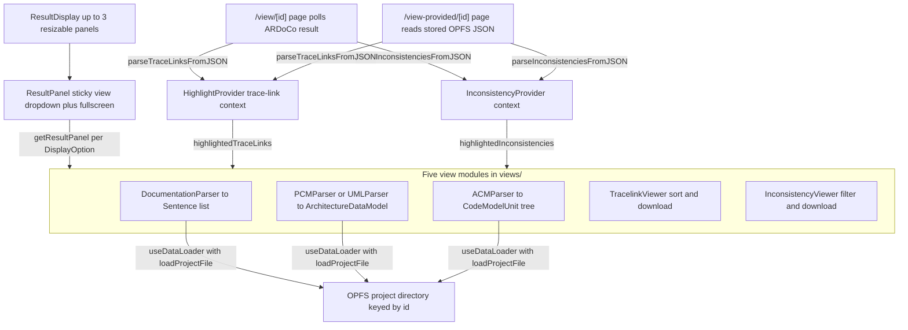

# Result viewer

The result viewer is the subsystem under `src/components/traceLinksResultViewer/` that renders an ARDoCo trace-link run: a resizable multi-panel workspace whose panels show the documentation, the architecture model, the code model, the recovered trace links, and (optionally) the detected inconsistencies. It consists of the panel chrome (`ResultDisplay`, `ResultPanel`, `FullScreenResultDialog`, `SearchResultMessage`, `Loading`, `TooltipInstruction`), the single `DisplayOption` → viewer mapping in `TabContent`, and five self-contained view modules (`views/documentation`, `views/architectureModel`, `views/codeModel`, `views/tracelinks`, `views/inconsistencies`), each conventionally split into `parser/`, `dataModel/`, and `viewer/` subfolders.

The viewer is mounted by [two result routes](../architecture.md): `/view/[id]` (backend-polled run) and `/view-provided/[id]` (stored project). Both wrap `ResultDisplay` in `HighlightProvider` and `InconsistencyProvider`, and the cross-panel highlight behavior those contexts implement is documented separately in [Highlighting](highlighting.md); this page covers layout, chrome, data sourcing, and the view modules themselves.

## Where the viewer gets its data

The most important data-sourcing fact about this subsystem is a split that is easy to miss:

- **The backend result is only two arrays.** On `/view/[id]`, the page polls `GET /api/get-result/{id}`, parses `response.result.traceLinks` with `parseTraceLinksFromJSON` and — when the query parameter requested them and they are present — `response.result.inconsistencies` with `parseInconsistenciesFromJSON`, and hands the arrays to the two highlight providers. No other result data comes from the backend.
- **Every artifact panel re-reads its file from browser storage.** The documentation, architecture-model, and code-model panels load their inputs themselves from the Origin Private File System directory keyed by the project id, via the generic `useDataLoader` hook plus `loadProjectFile`. On `/view-provided/[id]` even the trace-link and inconsistency JSON is parsed from stored files (`FileType.TRACELINKS` / `FileType.INCONSISTENCIES`) instead of from a backend response.

Because the wizard stores the submitted artifacts under the same `requestId` it later redirects to (see [Client-side project storage](client-storage.md)), the panels of a backend-polled result read exactly the files that were uploaded — the backend never echoes artifacts back.

The panel list itself is derived per route:

- `/view/[id]` builds `displayOptions` as the selected pipeline's `resultViewOptions` (from `TraceLinkTypes` in `src/components/dataTypes/TraceLinkTypes.tsx`) with `DisplayOption.TRACELINKS` unshifted first and `DisplayOption.INCONSISTENCIES` appended when inconsistency detection was requested.
- `/view-provided/[id]` maps the stored file types from `loadProjectMetaData` through `getResultViewOption(fileType)` in `src/components/dataTypes/DisplayOption.tsx`, so a stored project shows exactly the panels whose artifacts exist.

## Panel composition and chrome

`ResultDisplay` (`src/components/traceLinksResultViewer/ResultDisplay.tsx`) is the root component. It receives `id`, `traceLinkType`, and `displayOptions`, and composes:

- a horizontal `react-resizable-panels` `Group` with up to **three** `ResultPanel`s (`displayOptions.slice(0, 3)`) and a green `Separator` between adjacent panels; only the **first and last** panels are collapsible (`collapsible={index === 0 || index === length - 1}`, `collapsedSize={0}`),
- one `FullScreenResultDialog` driven by shared `selectedDialogView` state,
- one `SearchResultMessage` toast (see [Highlighting](highlighting.md) for its `MessageSource`/timestamp arbitration).

Because `displayOptions` can be longer than three (TransArC with inconsistencies yields five: `TRACELINKS, CODE_MODEL, ARCHITECTURE_MODEL, DOCUMENTATION, INCONSISTENCIES`), options beyond the first three are not lost — every `ResultPanel`'s dropdown lists **all** `displayOptions`, and the fullscreen dialog has a tab per option. Which panel shows what initially follows the option order: each `ResultPanel` seeds its local state from its `defaultView` prop (its index's option).

`ResultPanel` (`ResultPanel.tsx`) is a resizable `Panel` (`minSize={10}`) whose sticky header holds a Headless UI `Select` over all `displayOptions` — labels come from `displayOptionName(option, traceLinkType)`, where the tracelinks option is rendered as `"<name> (<alternative_name>) TraceLinks"`, e.g. `TransArC (sad-sam-code) TraceLinks` — plus a fullscreen button that opens the dialog for the panel's currently selected view. The panel body is `getResultPanel(selectedPanel, id, 10)`: the `headerOffset=10` keeps the viewer-internal sticky bars (sort/filter headers) below the panel dropdown.

`FullScreenResultDialog` (`FullScreenResult.tsx`) is a fixed-position Headless UI `Dialog` with a manual `TabGroup`: one `Tab` per display option, a close (`XMarkIcon`) button, and one `TabPanel` per option rendering `getResultPanel(option, id, 0)` — header offset 0, since there is no panel dropdown above. Tab changes flow back into `selectedDialogView`, so reopening the dialog keeps the last selected view.

Two small shared chrome pieces round out the subsystem: `Loading.tsx` provides `LoadingMessage` (centered gray title text) and `ErrorMessage` (red "An error occurred: …" text), and `TooltipInstruction` renders an absolutely positioned "?"-badge whose hover tooltip lists key-combo → explanation pairs (positioned bottom-right by default; each viewer supplies its own instructions).

*Panel composition and data flow: both result routes parse only trace-link/inconsistency arrays into the highlight contexts, artifact panels load their own files from OPFS through `useDataLoader`, and the viewers both render data and feed the highlight state.*

## The single DisplayOption → viewer mapping

`TabContent.getResultPanel(option, projectId, headerOffset)` (`src/components/traceLinksResultViewer/TabContent.tsx`) is the **only** place a `DisplayOption` is mapped to a viewer component:

| `DisplayOption` | Viewer component |
| --- | --- |
| `TRACELINKS` | `TraceLinkView` (`views/tracelinks/TracelinkViewer.tsx`), receives `headerOffset` |
| `CODE_MODEL` | `DisplayCodeModel` (`views/codeModel/CodeModelViewer.tsx`), receives `id` |
| `ARCHITECTURE_MODEL` | `DisplayArchitectureModel` (`views/architectureModel/ArchitectureModelViewer.tsx`), receives `id` |
| `DOCUMENTATION` | `DisplayDocumentation` (`views/documentation/DocumentationViewer.tsx`), receives `id` |
| `INCONSISTENCIES` | `InconsistencyViewer` (`views/inconsistencies/InconsistencyViewer.tsx`), receives `headerOffset` |

When adding a panel, update this switch plus the `DisplayOption` enum and its `displayOptionName` label; depending on the route, also extend the pipeline's `resultViewOptions` in `TraceLinkTypes` and/or the `getResultViewOption` file-type mapping. Unknown options return `null`. `ViewProps` is the shared artifact-viewer prop shape (`{ id: string }`).

## Shared data loading: `useDataLoader` + `loadProjectFile`

`src/util/useDataLoader.ts` is the generic loader hook every artifact panel uses:

1. It guards on mount: a first effect flips `isMounted`, and the loading effect runs only when `isMounted && id`; with a falsy `id` it just stops loading. This prevents storage access during server rendering/hydration.
2. For each `id` change it resets `data`/`fileContent`/`error`, sets `isLoading`, and calls the panel-supplied `loader(id)`.
3. The loader returns a `LoaderResult<T> = { data, fileContent }` — parsed model plus raw file text — and the hook surfaces `{ data, fileContent, isLoading, error }`; any loader throw becomes the error string `Failed to load or parse data: <message>`.

The three artifact loaders all shape their work the same way:

- `DisplayDocumentation` loads `FileType.DOCUMENTATION`, parses with `parseDocumentationText` into `Sentence[]`.
- `DisplayArchitectureModel` loads with fallback `FileType.ARCHITECTURE_MODEL_UML` and — because both architecture variants share the stored name `Architecture Model` (see [Client-side project storage](client-storage.md)) — dispatches on the metadata-resolved `result.fileType`: `ARCHITECTURE_MODEL_PCM` → `parsePCM`, `ARCHITECTURE_MODEL_UML` → `parseUMLModel`, anything else throws `Unknown architecture file type.`
- `DisplayCodeModel` loads `FileType.CODE_MODEL` and parses with `parseACMFile` into a `CodeModelUnit` tree.

Failure semantics are split by layer: a **missing** file (`loadProjectFile` → `null` on `NotFoundError`) is *not* an error — the loader returns `{data: null, fileContent: null}` and the viewer renders its fallback (empty sentence list; code-model raw-content `
`; "Architecture model not found or could not be loaded." message). A **parse** failure is thrown inside the loader and surfaces as the red `ErrorMessage` via the hook. The tracelinks and inconsistencies viewers use none of this — they render the shared highlight-context state and have their own `loading` flags fed by the result page.

## The five view modules

| Module | Parser | Data model | Viewer |
| --- | --- | --- | --- |
| documentation | `parseDocumentationText` | `Sentence` | `SentenceView` list |
| architectureModel | `parsePCM` / `parseUMLModel` (`fast-xml-parser`) | `AbstractComponent` subclasses + `Edge` | `UMLViewer` (d3) |
| codeModel | `parseACMFile` | `CodeModelUnit` tree | `ACMViewer` (d3 tree) |
| tracelinks | `parseTraceLinksFromJSON` | `TraceLink` | `TraceLinkView` + `TraceLinkItem` |
| inconsistencies | `parseInconsistenciesFromJSON` | `Inconsistency` subclasses | `InconsistencyViewer` + `InconsistencyItemDisplay` |

### Documentation

`parseDocumentationText` (`views/documentation/parser/DocumentationParser.tsx`) normalizes line endings, collapses excessive blank lines, and splits on `.`, `!`, or `?` followed by whitespace/newline/end, assigning each non-empty sentence an incrementing 1-based `identifier`. The identifiers are the join keys to the trace links (backend sentence numbers are shifted +1 by the trace-link parser below so both sides are 1-based).

`DocumentationViewer` renders the `Sentence[]` as a list of `SentenceView` rows (`identifier.` + content). Each row derives its background from the highlight contexts: trace-link highlight, inconsistency highlight, a gradient when both, and a distinctive border when the row is the click origin (`lastClickedSource`). Clicking a sentence calls `highlightElement(sentence.identifier, DisplayOption.DOCUMENTATION)` and `highlightInconsistencyWithSentence(sentence.identifier)` in one gesture.

### Architecture model

**Parsers.** Both parsers live in `views/architectureModel/parser/`, use `fast-xml-parser`, and return `{ components: AbstractComponent[], edges: Edge[] }`:

- `parsePCM` expects a Palladio `repository:Repository` root. It maps `interfaces__Repository` entries (by `id`/`entityName`) into an id→`Interface` map, then turns `components__Repository` entries into `Component`s. Provided and required roles (`providedInterface__OperationProvidedRole` / `requiredInterface__OperationRequiredRole`) become `uml:InterfaceRealization` and `uml:Usage` edges carrying the resolved `usedInterface`. Roles referencing an interface id missing from the map are skipped with a console warning; malformed XML or a missing root throws.
- `parseUMLModel` expects an XMI `uml:Model` with `@_`-prefixed attributes and walks `packagedElement`s recursively (packages recurse into children while skipping nested `uml:Usage` entries). `xmi:type` `uml:Class`/`uml:Component`/`uml:Interface`/`uml:Package` map to the data-model classes; owned attributes/operations become `Attribute`/`Operation`; `generalization`, `interfaceRealization` (client → supplier), and nested `uml:Usage` entries become edges. A post-pass resolves `edge.usedInterface` for realization/usage edges whose supplier is an `Interface` object, and components are deduplicated via their `equals` implementations.

**Data model.** `views/architectureModel/dataModel/ArchitectureDataModel.tsx` defines the abstract `AbstractComponent` (`id`, `name`, `type`, optional `x`/`y`) with subclasses `Package`, `Interface` (owned operations), `UMLClass` (attributes + operations), and `Component` (attributes, operations, used interface ids, provided interface ids), each with structural `equals`. `Edge` has `client`, `supplier`, `type` (union `uml:Generalization` | `uml:InterfaceRealization` | `uml:Usage` | `virtual:mergedEdge`), and an optional `usedInterface` reference.

**Viewer.** `UMLViewer` (`views/architectureModel/viewer/UMLViewer.tsx`) is d3-powered SVG rendering:

- `processUMLData` simplifies the graph before layout: an interface that is provided exactly once and used exactly once becomes a **pass-through** — it is removed from node rendering and replaced by a `virtual:mergedEdge` between provider and user, drawn by `UMLEdge` as paired provided/required **lollipop** symbols (`LollipopEdges.tsx`) labeled with the interface name and connected by a dashed line. Interfaces with exactly one attached edge are hidden as nodes and their edges drawn as short links.
- Positions come from a d3 force simulation (`forceLink` distance 200, `forceManyBody` −400, `forceCollide` radius 120, weak centering); on `end` the simulation computes a padded bounding box and the SVG `viewBox` is set to it, so the layout auto-fits. `d3.zoom` allows pan/zoom.
- Component boxes (`UMLComponentNode.tsx`) are canvas-measured, camelCase-wrapped label rectangles with the `<<component>>` stereotype and a component glyph, filled with a trace-link/inconsistency highlight gradient when applicable. Interfaces render as lollipop-style nodes whose hovered name opens the interface tooltip (`InterfaceTooltip.tsx`: provided/required label plus operations — note the operations list branch is inverted, so an interface *with* operations displays a "-" placeholder).
- Every click path (component, interface, merged edge) calls `highlightElement(id, DisplayOption.ARCHITECTURE_MODEL)` plus `highlightInconsistencyWithModelId(id)`, wiring the model panel into the cross-panel highlight engine.

When no parsed model is available the panel falls back to raw/not-found text; parse errors surface as `ErrorMessage`.

### Code model

**Parser.** `parseACMFile` (`views/codeModel/parser/ACMParser.tsx`) converts the flat ACM JSON (`codeItemRepository.repository`, an id → item map; a missing repository throws) into one nested `CodeModelUnit` tree:

1. every repository entry becomes a unit; `CodeCompilationUnit` names gain their `extension` and full path;
2. for compilation units, a chain of `CodePackage` units is synthesized from `pathElements`, keyed by a stable package id derived from the sanitized path so repeated prefixes are reused;
3. `content` id lists of `CodeCompilationUnit`/`ClassUnit`/`InterfaceUnit` link children (classes into files, methods into classes);
4. siblings with identical name and type are merged bottom-up to remove duplicates that arise from duplicated path references;
5. single-child `CodePackage` chains are collapsed, joining names with `/`;
6. the root is chosen (synthetic "Code Model" root when several top-level entries exist, the single child otherwise) and `setCodeModelUnitPaths` recomputes absolute paths.

**Viewer.** `ACMViewer` (`views/codeModel/viewer/ACMViewer.tsx`) renders the tree as a d3 cluster/tree layout (`nodeSize` 10 × 200): initially collapsed below depth 2, but a full-tree copy is kept in a ref so highlight computation always sees the complete hierarchy. `d3.zoom` is installed and an initial transform fits the drawn bounding box into the SVG (scale clamped to 0.1–1.5, 50 px padding).

Interactions: a plain click on `ACMNode` calls `highlightElement(node.data.id, DisplayOption.CODE_MODEL)`; **Ctrl+Click** toggles the node's subtree between `children` (visible) and `_children` (collapsed) in the tree state and forces a re-render via a copied reference. When trace links are highlighted (matched by `codeElementId`), every ancestor path edge of the matching nodes is drawn as a thick highlighted `ACMLink`, and an effect auto-expands any collapsed ancestors of the highlighted nodes so the matched elements become visible.

### Tracelinks

**Parser.** `parseTraceLinksFromJSON` (`views/tracelinks/parser/TraceLinkParser.tsx`) maps raw result entries into `TraceLink` objects per pipeline type — fields differ by what a pipeline relates:

| Pipeline (`traceLinkType.name`) | Parsed fields |
| --- | --- |
| `ArDoCode` (SAD_CODE) | sentence number (backend +1), code element |
| `ArCoTL` (SAM_CODE) | model element, code element (`sentenceNumber: null`) |
| `TransArC` (SAD_SAM_CODE) | sentence number (+1), model element, code element |
| `SWATTR` (SAD_SAM) | sentence number (+1), model element |

Unknown types log an error and yield an empty list; exceptions are caught and also yield `[]`. `TraceLink` (`views/tracelinks/dataModel/TraceLink.tsx`) stores `sentenceNumber` (nullable), model/code id and name, and a composite `id` of the form `` `${modelElementId}-${codeElementId}-${sentenceNumber}` `` that serves as the selection-origin key in the highlight context.

**Viewer.** `TraceLinkView` reads `traceLinks`, `traceLinkType`, `highlightedTraceLinks`, and `loading` from the trace-link context — it holds no own data loading. Its sticky header (top offset `headerOffset`) offers:

- type-dependent sort options: `Code`, `Model`, and `Sentence` comparators exist, but per pipeline the irrelevant one is removed (SAD_SAM has no code, SAD_CODE no model, SAM_CODE no sentence); comparisons fall back to element ids, and sentence sort treats missing numbers as largest;
- a **Highlights** toggle — when active, re-sorting (which also re-runs via an effect whenever `traceLinks` or the sort method changes) moves currently highlighted links to the top;
- `DownloadFileComponent` exporting `tracelinks.json`.

The sorting dropdown also resets to `"Sort By"` whenever a new `traceLinks` array arrives. Rows (`TraceLinkItem`) show Code / Model / Sentence fields driven by the same type flags, carry the element id as a title tooltip, and on click reset the inconsistency highlight then call `highlightSingleTraceLink(link)`. While `loading`, the panel shows "Generating traceLinks, this may take a few moments..."; an empty result set shows "No traceLinks found."

### Inconsistencies

**Parser.** `parseInconsistenciesFromJSON` (`views/inconsistencies/parser/InconsistencyParser.tsx`) maps each raw entry into one of two concrete classes by `type`: `TextEntityAbsentFromModelInconsistency` (`reason`, `sentenceNumber`) or `ModelEntityAbsentFromTextInconsistency` (`reason`, `modelElementId`). Unknown types log a warning and are dropped. The data model (`views/inconsistencies/dataModel/Inconsistency.tsx`) gives every inconsistency an id of `` `${type}-${reason}` `` extended by sentence number or model element id, plus `equals` used for comparisons in the viewer.

**Viewer.** `InconsistencyViewer` reads `inconsistencies` and `loading` from the inconsistency context. Its sticky header offers:

- a type filter (`All Types`, the two `InconsistencyType` values);
- `DownloadFileComponent` exporting `inconsistencies.json`.

The displayed list is a memoized filter + sort: primary by type, then by sentence number (text-absent-from-model) or model element id (model-absent-from-text), falling back to `reason`. While loading it shows "Generating inconsistencies, this may take a few moments..." and with zero items "No inconsistencies found." Each `InconsistencyItemDisplay` row shows type, sentence number or model id, and reason; a click resets the trace-link highlight and calls `highlightSingleInconsistency(inconsistency)`. A `TooltipInstruction` explains the two inconsistency meanings.

## JSON exports

`src/util/DownloadFileComponent.tsx` is the shared export button: it takes `fileName`, `prepareDataToExport`, and `title`, wraps the prepared payload in a `Blob`, and triggers an anchor download. Three exports exist in the app:

| File | Producer | Payload |
| --- | --- | --- |
| `tracelinks.json` | `TraceLinkView` | `{ traceLinkType: <pipeline name>, traceLinks: <sorted links> }` |
| `inconsistencies.json` | `InconsistencyViewer` | `{ inconsistencies: <all, unfiltered> }` |
| `ardoco_configuration.json` | wizard configuration step (`ManualInputSection`) | the current `traceLinkConfiguration` object |

The tracelinks export reflects the current sort order (the sorted array), while the inconsistencies export always dumps the full unfiltered list. `ardoco_configuration.json` is not part of the result viewer itself — it belongs to the configuration step described in [Project forms](project-forms.md) — but it shares the same download component.

## Operational notes

- **No cross-panel search coupling in the panels themselves:** the tracelinks and inconsistencies panels render whatever the highlight contexts hold, and `SearchResultMessage` is the only feedback surface for match counts (see [Highlighting](highlighting.md)).
- **Empty results are statuses, not errors:** missing artifact files render fallbacks, empty trace-link/inconsistency arrays render dedicated "No … found" messages, and highlight mutators no-op on empty collections — only storage exceptions and parse failures become `ErrorMessage`s.
- **The viewer is client-only:** all storage access happens behind the mounted guard of `useDataLoader` (and `loadProjectFile`'s own server-side guard), so the panels are safe under Next.js server rendering but always load after hydration.

## Change checklist: adding or altering a panel

1. Add the `DisplayOption` value and its `displayOptionName` label (`src/components/dataTypes/DisplayOption.tsx`).
2. Add the viewer under `views/<module>/` following the `parser/` `dataModel/` `viewer/` convention.
3. Register it in `TabContent.getResultPanel` — the single switch every panel and the fullscreen dialog go through.
4. Decide how options reach the viewer: pipeline `resultViewOptions` (`TraceLinkTypes.tsx`) for `/view`, `getResultViewOption` for stored file types on `/view-provided`.
5. If the panel shows an artifact, wire a `useDataLoader` loader against `loadProjectFile` with the right `FileType` and the parse-failure/missing-file behavior described above; if it shows results, consume the appropriate highlight context instead.
