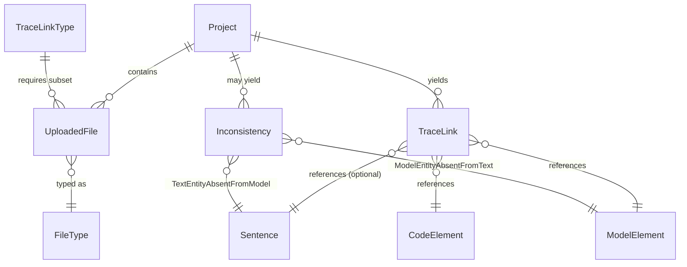

# Domain model

TraceView operates in the ARDoCo traceability domain. The application is not generic file upload: users combine specific software engineering artifacts (documentation, architecture models, code models) into trace-link and inconsistency-analysis runs, then explore the results side by side.

## Artifact / file types

The single authoritative enum is `FileType` in `src/components/dataTypes/FileType.tsx`:

| Value | Meaning |
|---|---|
| `DOCUMENTATION` (`"Documentation"`) | Software Architecture Documentation (SAD), a text artifact split into sentences |
| `ARCHITECTURE_MODEL_UML` (`"UML"`) | Architecture model (SAM) in UML/XMI form |
| `ARCHITECTURE_MODEL_PCM` (`"PCM"`) | Architecture model (SAM) in Palladio PCM form |
| `CODE_MODEL` (`"Code Model"`) | Code model extracted from source code |
| `TRACELINKS` (`"TraceLinks"`) | Trace-link result file (for the load-existing-project flow) |
| `INCONSISTENCIES` (`"Inconsistencies"`) | Inconsistency result file (load-existing-project flow) |
| `NONE` (`"Select file type"`) | Sentinel for "no file type selected" |

`convertStringToFileType` maps a stored string back to the enum; the special value `"Architecture Model"` (used by [client storage](architecture.md) as the on-disk name for both architecture-model variants, see `getStoredFileName`) defaults to `ARCHITECTURE_MODEL_UML`, and any unrecognized string falls back to `NONE`. Both architecture-model variants are treated as one logical "architecture model" input everywhere a single model file is required (pipeline selection, request building, and result display), even though they are distinct enum values.

The `DisplayOption` enum (`src/components/dataTypes/DisplayOption.tsx`) defines which result panels exist: `TRACELINKS`, `CODE_MODEL`, `ARCHITECTURE_MODEL`, `DOCUMENTATION`, `INCONSISTENCIES`. `displayOptionName` renders a human title, with the tracelinks panel titled from the trace-link type's `name`/`alternative_name`; `getResultViewOption` maps each `FileType` to its display option (both model variants map to `ARCHITECTURE_MODEL`) and throws for unknown file types. `MessageSource` (`src/components/dataTypes/MessageSource.tsx`) tags message provenance in the viewer: `TRACELINK`, `PROVIDED_PROJECT_ELEMENT` (a code element, documentation sentence, or architecture element), `INCONSISTENCY`, or `NONE`.

## The four pipeline combinations

The supported trace-link runs are defined as the `TraceLinkTypes` record in `src/components/dataTypes/TraceLinkTypes.tsx`. Each entry is a `TraceLinkType` with `name` (display/tool name), `alternative_name` (legacy hyphenated name, also accepted by `getTraceLinkTypeByName`), `api_name` (backend pipeline name, used to build the start endpoint), `info` text, a `checkCondition(uploadedFiles)` predicate that controls whether the option is selectable, the `providedFiles` it accepts, and the `resultViewOptions` it enables in the result viewer.

| Key | name | alternative_name | api_name | Required inputs (checkCondition / providedFiles) | Result view options |
|---|---|---|---|---|---|
| `SAD_SAM_CODE` | TransArC | `sad-sam-code` | `TransArC` | documentation **and** architecture model **and** code model | tracelinks + code model, architecture model, documentation |
| `SAD_SAM` | SWATTR | `sad-sam` | `SWATTR` | documentation **and** architecture model | tracelinks + architecture model, documentation |
| `SAD_CODE` | ArDoCode | `sad-code` | `ArDoCode` | documentation **and** code model | tracelinks + code model, documentation |
| `SAM_CODE` | ArCoTL | `sam-code` | `ArCoTL` | architecture model **and** code model | tracelinks + code model, architecture model |

The condition helpers (`hasArchitectureDocumentation`, `hasArchitectureModel`, `hasCodeModel`) treat either architecture-model variant as satisfying "architecture model". `getTraceLinkTypeByName` matches either `name` or `alternative_name` and is what the result page uses to reconstruct the pipeline from the `type` query parameter.

The same combinations are re-enforced at request-build time by `fetchArdocoApi` in `src/util/ArdocoApi.tsx`: a `switch` over the selected type's name assembles the multipart form (`inputText`, `inputCode`, `inputArchitectureModel`, plus `inputArchitectureModelFormat` carrying the PCM/UML `FileType` when a model is included), throws on missing required files, and rejects unknown types. The endpoint is `/api/<api_name lowercased>/start`, except that inconsistency runs go to `/api/find-inconsistencies/start`. The UI therefore never accepts arbitrary artifact combinations; the pipeline matrix is the domain contract.

*A project contains typed uploaded files; a chosen trace-link type requires a subset of them and produces trace links linking sentences, model elements, and code elements; the SAD_SAM run can additionally produce inconsistencies.*

## Trace link data model

`TraceLink` (`src/components/traceLinksResultViewer/views/tracelinks/dataModel/TraceLink.tsx`) links a `sentenceNumber` (nullable), a `modelElementId`/`modelElementName` pair, and a `codeElementId`/`codeElementName` pair, and derives the composite id `` `${modelElementId}-${codeElementId}-${sentenceNumber}` ``.

The backend JSON is parsed by `parseTraceLinksFromJSON` (`.../parser/TraceLinkParser.tsx`), which is pipeline-specific:

- `SAD_CODE`: `sentenceNumber` + `codeElementId` (model fields empty); sentence number becomes 1-based via `parseInt(entry.sentenceNumber) + 1`.
- `SAM_CODE`: `modelElementId` + `codeElementId`, `sentenceNumber` is `null`. Note the parser maps `codeElementId`/`codeElementName` into the `TraceLink` model-element slots and the model element into the code-element slots, preserving which side is "sent" vs "found".
- `SAD_SAM_CODE`: sentence number (+1), model element, and code element.
- `SAD_SAM`: sentence number (+1) and model element, no code element.

Unknown pipeline types log an error and yield an empty list; parse failures never throw to the caller.

The sample get-result payload `test/test-sadsam-json.json` shows the SAD_SAM shape: top-level `requestId`, `status` (`"OK"`), `message`, `traceLinkType` (`"SAD_SAM"`), and a `traceLinks` array whose entries carry `sentenceNumber` (0-based on the wire, hence the `+1`), `modelElementUid`, and `confidence`.

## Inconsistency data model

`Inconsistency` (`.../views/inconsistencies/dataModel/Inconsistency.tsx`) has exactly two concrete types, corresponding to the TEAM/MEAT analyses:

- `TextEntityAbsentFromModelInconsistency` (TEAM): a documentation sentence with no model counterpart; carries `sentenceNumber`.
- `ModelEntityAbsentFromTextInconsistency` (MEAT): a model element with no text counterpart; carries `modelElementId`.

Both extend the base class with a `reason` string and participate in the id scheme: base id is `${type}-${reason}`, extended to include the sentence number or model element id respectively. `equals` is defined per subclass, including the type-specific field, so deduplication in the viewer works on type + reason + anchor.

Inconsistency detection is intentionally narrow: it is only supported for the SAD_SAM (SWATTR) pipeline. This invariant is enforced in three places:

1. `ProjectUploadContext.updateFormData` resets `findInconsistencies` to `false` whenever the selected type is not `TraceLinkTypes.SAD_SAM` (`src/contexts/ProjectUploadContext.tsx`).
2. `fetchArdocoApi` throws if `findInconsistencies` is requested with any type other than SAD_SAM, and routes such runs to `/api/find-inconsistencies/start` (`src/util/ArdocoApi.tsx`).
3. The "Find Inconsistencies" checkbox in `ProjectDetailsStep` is disabled unless the selected type is SAD_SAM (`src/components/multiStepForm/steps/projectDetailsStep/ProjectDetailsStep.tsx`).

On the result side, inconsistencies are parsed from `response.result.inconsistencies` only when the `inconsistencies=true` query flag was set and the payload contains them (`src/app/view/[id]/page.tsx`).

## Trace link configuration

`TraceLinkConfiguration` is a plain string map (`interface TraceLinkConfiguration { [key: string]: string }`) defined in `src/contexts/ProjectUploadContext.tsx`. The `FormProvider` fetches the available configuration keys and defaults from the backend once per API address (`GET /api/configuration` with the `X-Target-API` header) and stores both the pristine values (`originalTraceLinkConfiguration`) and the editable copy inside `formData.traceLinkConfiguration`.

At submission, `fetchArdocoApi` serializes the configuration into the multipart field `additionalConfigs` as JSON **after filtering out entries whose value is the empty string** — i.e., only non-default/edited settings are sent, letting backend defaults apply for untouched keys.

## Project and run identity

Two id kinds exist and are used differently:

- **Backend `requestId`** — returned in the JSON response of a pipeline start call (`fetchArdocoApi` rejects responses lacking it) and echoed in the get-result payload (`"requestId": "SadSamResult:ji7b258c6c-..."` in the sample). It is the key for polling (`GET /api/get-result/<id>` in `src/app/view/[id]/page.tsx`, up to 240 s at 5 s intervals until `status` is `"OK"`; `ACCEPTED` keeps waiting, anything else surfaces the server `message` as an error) and for client-side persistence.
- **Client-generated `uuidv4`** — produced by `MultiStepFormLoadProject.handleSubmit` when visualizing pre-existing trace links; there is no backend run, so a fresh UUID acts as the storage id.

Either id is used as the OPFS (Origin Private File System) directory key in `src/util/ClientFileStorage.tsx`: `storeProjectFiles`/`storeProjectMetadata` write uploaded files and a `project.meta.json` under `getDirectoryHandle(projectId, {create: true})`, and `loadProjectFile`/`loadProjectMetaData`/`deleteProjectDirectory` read or remove that directory. Ids are URI-encoded when placed in routes (`encodeURIComponent(result.requestId)` → `/view/<id>`; `encodeURIComponent(storageId)` → `/view-provided/<id>`) and decoded again in the result page (`decodeURIComponent(id)`), which also sets/clears it as the current project id in the navigation context. Changing how ids are generated or displayed would therefore ripple through routes, the navigation context, and the storage directory layout.

## User-facing concepts to keep stable

- A project is a traceability run, not just a folder of uploads.
- The user chooses one of the four supported trace-link types, not an arbitrary backend job; eligibility comes from which artifact types were uploaded.
- Architecture models may come in PCM or UML form, but both are one logical "architecture model" input.
- Inconsistency analysis is an add-on of the SWATTR (SAD_SAM) pipeline only.
- The result viewer is centered on side-by-side comparison across artifact types, with the tracelinks panel always first.

## Source of truth for domain rules

- `src/components/dataTypes/` for file, display, message-source, and trace-link-type definitions
- `src/util/ArdocoApi.tsx` for pipeline validation, endpoint construction, and configuration submission
- `src/contexts/ProjectUploadContext.tsx` for form state and the configuration fetch
- `src/components/traceLinksResultViewer/views/` for result domain models and parsers
- `src/app/view/[id]/page.tsx` for polling and result assembly
- `test/test-sadsam-json.json` for the get-result payload shape
