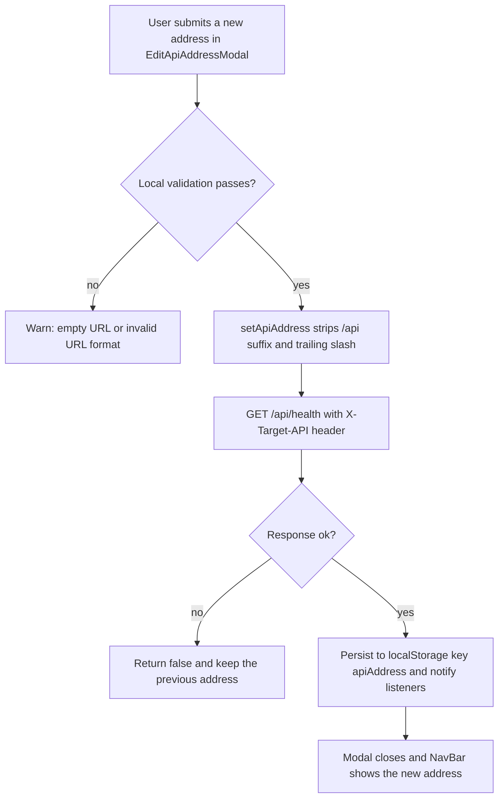
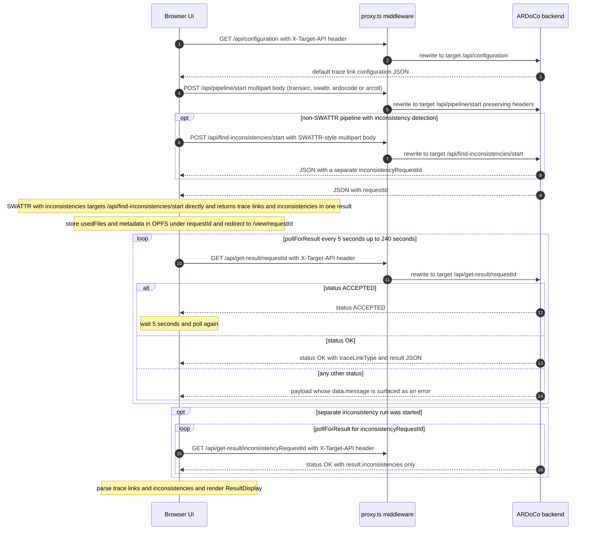

# ARDoCo backend API

TraceView ships no backend of its own. Every conversation with an ARDoCo REST backend happens through one indirection: the browser fetches same-origin `/api/*` URLs, and the app-wide proxy middleware in `src/proxy.ts` rewrites those requests onto whatever backend address is configured in `ApiAddressContext` (default `https://rest.ardoco.de`). This page documents that boundary: the middleware contract, the five endpoints the frontend actually calls, the multipart submission payload, how inconsistency detection runs alongside the main pipeline run, the result polling lifecycle, and how users manage the backend address.

The frontend side of this boundary is consumed by exactly four call sites:

| Caller | Request | Purpose |
| --- | --- | --- |
| `src/contexts/ApiAddressContext.tsx` | `GET /api/health` | Validate a candidate backend address before saving it. |
| `src/contexts/ProjectUploadContext.tsx` | `GET /api/configuration` | Load the default trace-link configuration for the wizard. |
| `src/util/ArdocoApi.tsx` (`fetchArdocoApi`) | `POST /api/{pipeline}/start`, plus a parallel `POST /api/find-inconsistencies/start` when inconsistency detection is requested for a non-SWATTR pipeline | Multipart project submission. |
| `src/app/view/[id]/page.tsx` (`pollForResult`) | `GET /api/get-result/{id}` | Poll for the finished result — once for the main run and, when one was started, again for the separate inconsistency run. |

## The `/api/*` boundary and the `X-Target-API` middleware

`src/proxy.ts` is the Next.js proxy file convention for the whole app: its `config.matcher` is `'/api/:path*'`, so it runs for every `/api/*` request. The repository defines no local API route handlers — anything under `/api/` is forwarded to the backend. The middleware reads the `X-Target-API` request header (supplied by the client from `ApiAddressContext`), and rewrites the request with `NextResponse.rewrite` to `{target origin}/api/<same path without the leading /api/>`, passing the original request headers through. The Next.js server therefore performs the actual cross-origin call, and the UI stays independent of the backend host as long as an address is configured.

The middleware enforces its contract before rewriting:

| Condition | Response |
| --- | --- |
| `X-Target-API` header missing | `400` — "X-Target-API header is missing." |
| Header value is not a parseable URL (`new URL` throws) | `400` — "Invalid URL format in X-Target-API header." |
| Target protocol is neither `http:` nor `https:` | `403` — "Only HTTP/S targets are allowed." |

Only after all three checks pass does the middleware rewrite to `` `${targetUrl.origin}/api/${request.nextUrl.pathname.replace('/api/', '')}` ``.

## API address management

`ApiAddressContext` (`src/contexts/ApiAddressContext.tsx`) is the single owner of the backend address and is mounted in the root layout around the entire application, so every call site reads the same value.

- **localStorage as an external store.** The address is not React state hydrated in an effect; it is exposed through `useSyncExternalStore`. A module-level listener set plus the window `storage` event forms the subscription, `getSnapshot` returns `localStorage.getItem('apiAddress') || DEFAULT_API` (default `https://rest.ardoco.de`), and `getServerSnapshot` returns `null`. Server rendering and the first hydration therefore see `null`, which the `NavBar` renders as `Connected API: loading`; afterwards every subscriber reads the stored address — or the default — directly from localStorage, so there is no separate copy of the value to fall out of sync.
- **Input cleaning.** `setApiAddress` cleans the user input before doing anything with it: the regex `replace(/\/api\/?.*$/, "")` strips a trailing `/api` path (so `http://host:8081/api` or `http://host:8081/api/` becomes `http://host:8081`), and a trailing slash is removed. This lets users paste either a bare base URL or a full API root.
- **Health-check gate.** The cleaned address is probed with `GET /api/health` through the middleware (`X-Target-API: cleanedAddress`). Only when the response is `ok` does the provider persist the cleaned address to `localStorage`, notify the store listeners — making it the active address everywhere — and return `true`. A failed probe or a thrown network error returns `false` and leaves the active address unchanged.
- **`EditApiAddressModal`** (`src/components/EditApiAddressModal.tsx`) validates locally before probing: an empty input warns "URL cannot be empty." and a value that fails `new URL(input)` warns "Please enter a valid URL format (e.g., http://example.com)." If `setApiAddress` then fails, the modal shows "Could not connect to the API at this address." and stays open; on success it closes. The input is re-synced to the current address whenever the address changes (adjusted during render) and reset when the modal closes.
- **`NavBar` indicator** (`src/components/NavBar.tsx`). Both the desktop header and the mobile menu show a `Connected API: <address>` pill with a pencil button that opens the edit modal; the mobile variant closes the menu before opening it.

*Validation gates a new backend address must pass before it becomes active; a failed probe keeps the previous address.*

Changing the address has a global effect: `ProjectUploadContext` re-fetches `/api/configuration` whenever `apiAddress` changes, the `/view/[id]` page restarts polling (its fetch callback depends on `apiAddress` and `id`), and the separate inconsistency outcome is keyed by `{apiAddress}|{requestId}`, so a changed address discards results fetched from the old backend.

## Endpoint catalog

### `GET /api/health`

Called only by `ApiAddressContext.setApiAddress` as a reachability probe for a candidate address. The response body is not inspected — any `ok` response means the address is accepted and persisted.

### `GET /api/configuration`

Called by the `FormProvider` in `src/contexts/ProjectUploadContext.tsx` whenever it has an `apiAddress` (and re-run whenever the address changes). The parsed payload — a flat object of string configuration keys/values (`TraceLinkConfiguration`) — is stored as both `originalTraceLinkConfiguration` and `formData.traceLinkConfiguration`, and exposed with `configurationLoading` / `configurationError`. A non-OK response sets `configurationError` to `HTTP error! status: {status}. Are you connected to the correct API?`, which the wizard's Configuration step renders through its `ErrorState`. This default configuration is the baseline for the wizard's "Configure ardoco" step (defaults, file upload, or manual editing; see [Project forms](../architecture/project-forms.md)).

### `POST /api/{pipeline}/start`

The main submission endpoint, called by `fetchArdocoApi` in `src/util/ArdocoApi.tsx`. The path segment is the selected pipeline's `api_name` lowercased:

| Pipeline (display name) | `TraceLinkTypes` key | `api_name` | Start path |
| --- | --- | --- | --- |
| TransArC | `SAD_SAM_CODE` | `TransArC` | `/api/transarc/start` |
| SWATTR | `SAD_SAM` | `SWATTR` | `/api/swattr/start` |
| ArDoCode | `SAD_CODE` | `ArDoCode` | `/api/ardocode/start` |
| ArCoTL | `SAM_CODE` | `ArCoTL` | `/api/arcotl/start` |

When inconsistency detection is requested for a non-SWATTR pipeline, this call carries only the main run; the inconsistency run goes to the endpoint below. The multipart payload contract is specified in [Submission payload contract](#submission-payload-contract-fetchardocoapi) below. A successful response must contain a `requestId`, which becomes the browser-storage key for the project's artifacts and the `/view/{id}` route parameter.

### `POST /api/find-inconsistencies/start`

Used whenever the user enables inconsistency detection, in one of two ways:

1. **Same run (SWATTR).** For the `SAD_SAM` (SWATTR) pipeline the start path itself switches to this endpoint; the single backend run returns trace links and inconsistencies together, and `fetchArdocoApi` reports its `requestId` as `inconsistencyRequestId`.
2. **Separate run (every other pipeline).** For TransArC, ArDoCode and ArCoTL the main run keeps its own endpoint and a second, SWATTR-shaped run against this endpoint is started in parallel (`Promise.allSettled`). Its `requestId` is returned as `inconsistencyRequestId`; if it fails to start, the failure is logged and returned as `inconsistencyError` while the main result is unaffected.

Whether inconsistency detection is offered at all is a file-availability decision, not a pipeline decision: `canFindInconsistencies` requires an architecture documentation and an architecture model, `ProjectUploadContext.updateFormData` resets the flag whenever the file set no longer satisfies it, and `ProjectDetailsStep` disables the checkbox under the same condition. `fetchArdocoApi` re-checks the files before starting a separate run and throws `Finding inconsistencies requires documentation and an architecture model.` if they are missing.

### `GET /api/get-result/{id}`

Called by `pollForResult` in `src/app/view/[id]/page.tsx` to drive the asynchronous pipeline run; the lifecycle is documented in [Result polling lifecycle](#result-polling-lifecycle) below. On `status: "OK"` the payload carries `traceLinkType`, `result.traceLinks`, and — when inconsistency detection was part of the run — `result.inconsistencies`. The page polls this endpoint a second time (with the separately URL-encoded inconsistency `requestId`) when a separate inconsistency run was started; only that run's inconsistencies are consumed, its SAD-SAM trace links are ignored.

## Submission payload contract (`fetchArdocoApi`)

`fetchArdocoApi(apiAddress, projectName, selectedTraceLinkType, inputFiles, findInconsistencies, config)` assembles a `FormData` body and posts it with only the `X-Target-API` header set. It returns an `ArdocoApiResponse`: `{ jsonResult, usedFiles, inconsistencyRequestId?, inconsistencyError? }`, where `inconsistencyRequestId` equals `jsonResult.requestId` for a SWATTR run with inconsistencies, is a separate id for the other pipelines, and is `undefined` when no inconsistencies were requested.

**Common fields**

- `projectName` — always appended.
- `additionalConfigs` — appended only when a configuration object was provided. The configuration is filtered to drop every entry whose value is the empty string, then serialized with `JSON.stringify` and sent as a single JSON string field. This is how the wizard's configuration step (defaults, uploaded file, or manual edits) reaches the backend.

**Per-pipeline fields** (each `input*` field carries the raw `File` of the first uploaded file matching the required `FileType`, found by `findFile`; the architecture model accepts either PCM or UML):

| Pipeline | Fields appended | `usedFiles` returned |
| --- | --- | --- |
| TransArC (`SAD_SAM_CODE`) | `inputCode`, `inputText`, `inputArchitectureModel`, `inputArchitectureModelFormat` | code, documentation, architecture model |
| ArDoCode (`SAD_CODE`) | `inputCode`, `inputText` | code, documentation |
| ArCoTL (`SAM_CODE`) | `inputCode`, `inputArchitectureModel`, `inputArchitectureModelFormat` | code, architecture model |
| SWATTR (`SAD_SAM`) | `inputText`, `inputArchitectureModel`, `inputArchitectureModelFormat` | documentation, architecture model |

`inputArchitectureModelFormat` is set to the architecture file's `FileType` value (`"PCM"` or `"UML"`) and is the discriminant that tells the backend which model format was uploaded.

**Guard errors** (all thrown before any fetch happens):

- No pipeline selected → `No selectedTraceLinkType provided`.
- A required file is missing for the selected pipeline → `Missing required files for {pipeline}.`
- A type outside the four known pipelines reaches the switch → `Unsupported trace link type: {type}`.
- A separate inconsistency run requested without documentation or architecture model → `Finding inconsistencies requires documentation and an architecture model.`

**Run orchestration**

- *Single-run path* (no inconsistencies, or SWATTR with inconsistencies): one `startRun` call to the selected endpoint; the response's `requestId` becomes `inconsistencyRequestId` when inconsistencies were requested.
- *Separate-run path* (other pipelines with inconsistencies): the main run and the inconsistency run are started in parallel via `Promise.allSettled`. A rejected main run is rethrown and fails the submission; a rejected inconsistency run is only logged and returned as `inconsistencyError`, and the documentation and architecture model are appended to `usedFiles` so the result view can display them alongside the inconsistencies.

**Response handling**

- A non-OK HTTP response throws `API call failed.`; a response body without `requestId` throws `Invalid API response.`; every caught error is rethrown as `API call failed: {message}`.
- On success the function returns the `ArdocoApiResponse` described above, with `usedFiles` matching the files appended to the request(s), in pipeline order.

**What the caller does with it** (`src/components/multiStepForm/MultiStepFormNewProject.tsx`): after a successful submission the wizard stores `usedFiles` (plus metadata for all uploaded files, including the `inconsistencyRequestId`) in browser OPFS under the returned `requestId` via `storeProjectFiles` / `storeProjectMetadata` (see [Client storage](../architecture/client-storage.md)), then routes to `/view/{encodedRequestId}?type={pipeline name}&inconsistencies={flag}`. The flag encodes where the inconsistencies come from: `failed` (the separate run could not start), `false` (not requested), `true` (same run as the trace links), or the separate run's `requestId`. On a submission error the `LoadingErrorModal` offers **Retry** — which only closes the modal so the user can resubmit from the Summary step — or **View Files Only**, which makes no API call: it stores the uploaded files under a fresh `uuidv4` id and routes to `/view-provided/{id}` when storage succeeds.

## Result polling lifecycle

`pollForResult` owns the asynchronous run:

- It `GET`s `/api/get-result/{id}` with `X-Target-API` and the caller's `AbortSignal` every **5 seconds** for up to **240 seconds** (4 minutes), throwing `Polling was aborted.` when the signal is already aborted at the top of the loop.
- `status: "OK"` resolves with the whole payload; the page then parses `response.traceLinkType` + `response.result.traceLinks` and — when present — `response.result.inconsistencies` into the viewer's typed models.
- `status: "ACCEPTED"` keeps polling after a 5-second wait.
- Any other status throws `An error occurred while running the pipeline in ARDoCo: \n{data.message}` — the backend's message is surfaced verbatim.
- When the time budget is exhausted it throws `The result is still processing. Please try again later.`

**Abort ownership.** Polling runs on local `AbortController`s, not on the shared `NavigationContext` controller: the mount effect creates a controller, calls `fetchResult` and aborts it on cleanup, so unmounting — or any dependency change, since `fetchResult` depends on `apiAddress` and `id` — ends polling, and a superseded (aborted) run never touches state. `AbortError`s are swallowed, so polling ends silently. Leaving a project still confirms the navigation modal, deletes the OPFS project directory and aborts the `NavigationContext` controller, but no request consumes that signal anymore: the only remaining consumer, `/view-provided`'s error banner, forwards it to a retry callback that is rendered with `retryAllowed={false}`.

**Separate inconsistency polling.** When the result view knows about a separate inconsistency run (from the URL parameter or the stored project metadata via `loadInconsistencyRequestId`), a dedicated effect polls `/api/get-result/{encodeURIComponent(requestId)}` for it alongside the trace-link polling, with its own controller. The outcome is keyed by `{apiAddress}|{requestId}` so loading and errors are derived during render and invalidated when the address or id changes; only the parsed inconsistencies are used, and failures are recorded in `separateOutcome` (falling back to "The inconsistency detection failed.") rather than in the page-level error.

Polling errors and the timeout surface in `LoadingErrorModal` with **Retry** (clearing the error and restarting `fetchResult` with a fresh local `AbortController`) and **View Files Only** (clearing the error and stopping the loading state, rendering the panels without parsed trace links).

Note one asymmetry: `pollForResult` parses every poll response as JSON without checking `response.ok`, so the middleware's plain-text `400`/`403` rejections surface as JSON parse errors rather than as backend messages — unlike `startRun`/`fetchArdocoApi`, which check `response.ok` before parsing.

## End-to-end sequence

*Submission-to-result flow across the three tiers: the browser targets same-origin `/api/*` URLs with the `X-Target-API` header, the middleware in `src/proxy.ts` validates and rewrites each call onto the configured backend, and the result page polls `get-result` until the run (and, if started, the separate inconsistency run) finishes.*

## Invariants and failure semantics

- **All backend traffic flows through the middleware.** There are no direct cross-origin fetches; if `X-Target-API` is ever absent from a request the middleware rejects it with `400` before any backend call happens.
- **Inconsistency detection is available for every pipeline but driven by file availability.** SWATTR returns trace links and inconsistencies from one run; the other pipelines get a second parallel SWATTR-shaped run whose failure degrades gracefully (`inconsistencyError`) instead of failing the submission. Gating lives in three places — form state (`ProjectUploadContext`), the UI (`ProjectDetailsStep` checkbox), and the request builder (`fetchArdocoApi` file check) — so changing one layer alone cannot enable an impossible run.
- **The address is validated before it is trusted.** An address only becomes active after a successful `/api/health` probe; the previously active address survives a failed change.
- **Every polling effect owns its abort controller.** Restarting polling (address change, retry) or leaving the page aborts in-flight polls; aborted runs never write state, and the shared `NavigationContext` controller — still aborted, together with the OPFS directory deletion, on confirmed navigation — no longer carries any request signal.
