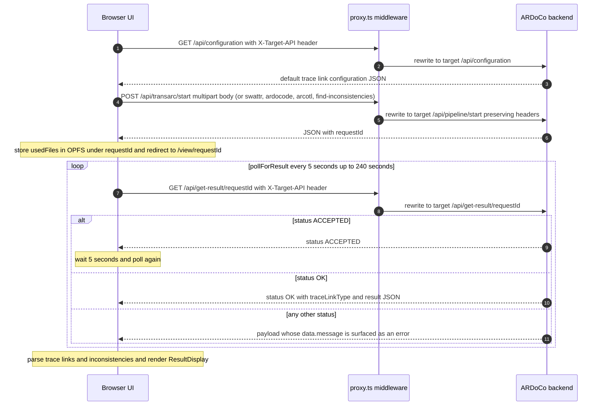

# ARDoCo backend API

TraceView ships no backend of its own. Every conversation with an ARDoCo REST backend happens through one indirection: the browser fetches same-origin `/api/*` URLs, and the app-wide proxy middleware in `src/proxy.ts` rewrites those requests onto whatever backend address is configured in `ApiAddressContext` (default `https://rest.ardoco.de`). This page documents that boundary: the middleware contract, the five endpoints the frontend actually calls, the multipart submission payload, the result polling lifecycle, and how users manage the backend address.

The frontend side of this boundary is consumed by exactly four call sites:

| Caller | Request | Purpose |
| --- | --- | --- |
| `src/contexts/ApiAddressContext.tsx` | `GET /api/health` | Validate a candidate backend address before saving it. |
| `src/contexts/ProjectUploadContext.tsx` | `GET /api/configuration` | Load the default trace-link configuration for the wizard. |
| `src/util/ArdocoApi.tsx` (`fetchArdocoApi`) | `POST /api/{pipeline}/start` or `POST /api/find-inconsistencies/start` | Multipart project submission. |
| `src/app/view/[id]/page.tsx` (`pollForResult`) | `GET /api/get-result/{id}` | Poll for the finished result. |

## The `/api/*` boundary and the `X-Target-API` middleware

`src/proxy.ts` is the Next.js proxy file convention for the whole app: its `config.matcher` is `'/api/:path*'`, so it runs for every `/api/*` request. The repository defines no local API route handlers — anything under `/api/` is forwarded to the backend. The middleware reads the `X-Target-API` request header (supplied by the client from `ApiAddressContext`), and rewrites the request with `NextResponse.rewrite` to `{target origin}/api/<same path without the leading /api/>`, passing the original request headers through. The Next.js server therefore performs the actual cross-origin call, and the UI stays independent of the backend host as long as an address is configured.

The middleware enforces its contract before rewriting:

| Condition | Response |
| --- | --- |
| `X-Target-API` header missing | `400` — "X-Target-API header is missing." |
| Header value is not a parseable URL (`new URL` throws) | `400` — "Invalid URL format in X-Target-API header." |
| Target protocol is neither `http:` nor `https:` | `403` — "Only HTTP/S targets are allowed." |

Only after all three checks pass does the middleware rewrite to `` `${targetUrl.origin}/api/${request.nextUrl.pathname.replace('/api/', '')}` ``.

## API address management

`ApiAddressContext` (`src/contexts/ApiAddressContext.tsx`) is the single owner of the backend address and is mounted in the root layout around the entire application, so every call site reads the same value.

- **Default and hydration.** The address defaults to `https://rest.ardoco.de`. On mount the provider hydrates from the `localStorage` key `apiAddress` if present, otherwise it applies the default. Until hydration completes the state is `null`, which the `NavBar` renders as `Connected API: loading`.
- **Input cleaning.** `setApiAddress` cleans the user input before doing anything with it: the regex `replace(/\/api\/?.*$/, "")` strips a trailing `/api` path (so `http://host:8081/api` or `http://host:8081/api/` becomes `http://host:8081`), and a trailing slash is removed. This lets users paste either a bare base URL or a full API root.
- **Health-check gate.** The cleaned address is probed with `GET /api/health` through the middleware (`X-Target-API: cleanedAddress`). Only when the response is `ok` does the provider persist the cleaned address to `localStorage` and update state, returning `true`. A failed probe or a thrown network error returns `false` and leaves the active address unchanged.
- **`EditApiAddressModal`** (`src/components/EditApiAddressModal.tsx`) validates locally before probing: an empty input warns "URL cannot be empty." and a value that fails `new URL(input)` warns "Please enter a valid URL format (e.g., http://example.com)." If `setApiAddress` then fails, the modal shows "Could not connect to the API at this address." and stays open; on success it closes. The input is re-synced to the current address whenever the address changes or the modal closes.
- **`NavBar` indicator** (`src/components/NavBar.tsx`). The desktop header shows `Connected API: <address>` with a pencil button that opens the edit modal. The mobile menu does not expose the address editor.

Changing the address has a global effect: `ProjectUploadContext` re-fetches `/api/configuration` and the `/view/[id]` page re-polls `/api/get-result/{id}` whenever `apiAddress` changes, because both effects depend on it.

## Endpoint catalog

### `GET /api/health`

Called only by `ApiAddressContext.setApiAddress` as a reachability probe for a candidate address. The response body is not inspected — any `ok` response means the address is accepted and persisted.

### `GET /api/configuration`

Called by the `FormProvider` in `src/contexts/ProjectUploadContext.tsx` whenever it has an `apiAddress` (and re-run whenever the address changes). The parsed payload — a flat object of string configuration keys/values (`TraceLinkConfiguration`) — is stored as both `originalTraceLinkConfiguration` and `formData.traceLinkConfiguration`, and exposed with `configurationLoading` / `configurationError`. A non-OK response sets `configurationError` to `HTTP error! status: {status}. Are you connected to the correct API?`, which the wizard's Configuration step renders through its `ErrorState`. This default configuration is the baseline for the wizard's "Configure ardoco" step (defaults, file upload, or manual editing; see [Project forms](../architecture/project-forms.md)).

### `POST /api/{pipeline}/start`

The submission endpoint, called by `fetchArdocoApi` in `src/util/ArdocoApi.tsx`. The path segment is the selected pipeline's `api_name` lowercased:

| Pipeline (display name) | `TraceLinkTypes` key | `api_name` | Start path |
| --- | --- | --- | --- |
| TransArC | `SAD_SAM_CODE` | `TransArC` | `/api/transarc/start` |
| SWATTR | `SAD_SAM` | `SWATTR` | `/api/swattr/start` |
| ArDoCode | `SAD_CODE` | `ArDoCode` | `/api/ardocode/start` |
| ArCoTL | `SAM_CODE` | `ArCoTL` | `/api/arcotl/start` |

The multipart payload contract is specified in [Submission payload contract](#submission-payload-contract-fetchardocoapi) below. A successful response must contain a `requestId`, which becomes the browser-storage key for the project's artifacts and the `/view/{id}` route parameter.

### `POST /api/find-inconsistencies/start`

Used instead of the pipeline start endpoint when the user enables inconsistency detection. This path is restricted to the `SAD_SAM` (SWATTR) pipeline and is enforced at three layers:

1. `ProjectUploadContext.updateFormData` resets `findInconsistencies` to `false` whenever the resulting selected trace-link type is not `SAD_SAM`.
2. `ProjectDetailsStep` disables the "Find Inconsistencies" checkbox unless the selected type is `SAD_SAM`.
3. `fetchArdocoApi` throws `Find inconsistencies is only supported for SWATTR trace link type.` if it is still asked to use the endpoint for another type — the backend-facing guard of last resort.

Because it is only reachable for SWATTR, the request carries the same multipart fields as the SWATTR start call.

### `GET /api/get-result/{id}`

Called by `pollForResult` in `src/app/view/[id]/page.tsx` to drive the asynchronous pipeline run; the lifecycle is documented in [Result polling lifecycle](#result-polling-lifecycle) below. On `status: "OK"` the payload carries `traceLinkType`, `result.traceLinks`, and — when inconsistency detection was requested — `result.inconsistencies`.

## Submission payload contract (`fetchArdocoApi`)

`fetchArdocoApi(apiAddress, projectName, selectedTraceLinkType, inputFiles, findInconsistencies, config)` assembles a `FormData` body and posts it with only the `X-Target-API` header set.

**Common fields**

- `projectName` — always appended.
- `additionalConfigs` — appended only when a configuration object was provided. The configuration is filtered to drop every entry whose value is the empty string, then serialized with `JSON.stringify` and sent as a single JSON string field. This is how the wizard's configuration step (defaults, uploaded file, or manual edits) reaches the backend.

**Per-pipeline fields** (each `input*` field carries the raw `File` of the first uploaded file matching the required `FileType`, found by `findFile`; the architecture model accepts either PCM or UML):

| Pipeline | Fields appended | `usedFiles` returned |
| --- | --- | --- |
| TransArC (`SAD_SAM_CODE`) | `inputCode`, `inputText`, `inputArchitectureModel`, `inputArchitectureModelFormat` | code, documentation, architecture model |
| ArDoCode (`SAD_CODE`) | `inputCode`, `inputText` | code, documentation |
| ArCoTL (`SAM_CODE`) | `inputCode`, `inputArchitectureModel`, `inputArchitectureModelFormat` | code, architecture model |
| SWATTR (`SAD_SAM`) | `inputText`, `inputArchitectureModel`, `inputArchitectureModelFormat` | documentation, architecture model |

`inputArchitectureModelFormat` is set to the architecture file's `FileType` value (`"PCM"` or `"UML"`) and is the discriminant that tells the backend which model format was uploaded.

**Guard errors** (all thrown before any fetch happens):

- No pipeline selected → `No selectedTraceLinkType provided`.
- `findInconsistencies` requested for a type other than `SAD_SAM` → `Find inconsistencies is only supported for SWATTR trace link type.`
- A required file is missing for the selected pipeline → `Missing required files for {pipeline}.`
- A type outside the four known pipelines reaches the switch → `Unsupported trace link type: {type}`.

**Response handling**

- A non-OK HTTP response throws `API call failed.`; a response body without `requestId` throws `Invalid API response.`; every caught error is rethrown as `API call failed: {message}`.
- On success the function returns `{ jsonResult, usedFiles }`, where `usedFiles` is exactly the list of uploaded files appended to the request, in pipeline order.

**What the caller does with it** (`src/components/multiStepForm/MultiStepFormNewProject.tsx`): on success the wizard stores `usedFiles` (plus metadata for all uploaded files) in browser OPFS under the returned `requestId` via `storeProjectFiles` / `storeProjectMetadata`, then redirects to `/view/{encodedRequestId}?type={pipeline name}&inconsistencies={flag}`. On a submission error it shows the `LoadingErrorModal` ("An error occurred while processing your request. Please try again.") whose **View Files Only** path re-runs the submission and, if storage succeeds, routes to `/view-provided/{requestId}` so the artifacts remain inspectable without a backend result.

## Result polling lifecycle

`pollForResult` owns the asynchronous run:

- It `GET`s `/api/get-result/{id}` with `X-Target-API` every **5 seconds** for up to **240 seconds** (4 minutes).
- `status: "OK"` resolves with the whole payload; the page then parses `response.traceLinkType` + `response.result.traceLinks` and — when the query parameter requested them and they are present — `response.result.inconsistencies` into the viewer's typed models.
- `status: "ACCEPTED"` keeps polling after a 5-second wait.
- Any other status throws `An error occurred while running the pipeline in ardoco: \n{data.message}` — the backend's message is surfaced verbatim.
- When the time budget is exhausted it throws `The result is still processing. Please try again later.`

The polling fetch runs with the shared `NavigationContext` `AbortController` signal, and `AbortError`s are swallowed: leaving the project (which confirms the navigation modal, deletes the OPFS project directory, and aborts the controller) ends polling silently. Polling errors and the timeout surface in `LoadingErrorModal` with **Retry** (restarting `pollForResult`) and **View Files Only** (rendering the panels without parsed trace links).

Note one asymmetry: `pollForResult` parses every poll response as JSON without checking `response.ok`, so the middleware's plain-text `400`/`403` rejections surface as JSON parse errors rather than as backend messages — unlike `fetchArdocoApi`, which checks `response.ok` before parsing.

## End-to-end sequence

*Submission-to-result flow across the three tiers: the browser targets same-origin `/api/*` URLs with the `X-Target-API` header, the middleware in `src/proxy.ts` validates and rewrites each call onto the configured backend, and the result page polls `get-result` until the run finishes.*

## Invariants and failure semantics

- **All backend traffic flows through the middleware.** There are no direct cross-origin fetches; if `X-Target-API` is ever absent from a request the middleware rejects it with `400` before any backend call happens.
- **Inconsistency detection is SWATTR-only**, enforced in the form state (`ProjectUploadContext`), the UI (`ProjectDetailsStep` checkbox), and the request builder (`fetchArdocoApi` guard) — changing one layer alone does not lift the restriction.
- **The address is validated before it is trusted.** An address only becomes active after a successful `/api/health` probe; the previously active address survives a failed change.
- **Address changes propagate.** Both the configuration fetch and the result poll re-run when `apiAddress` changes, so pointing the app at a different backend re-loads configuration and re-polls an in-flight or finished run.
- **`requestId` is the join key.** The backend's `requestId` names the OPFS project directory, the `/view/{id}` route, and the `get-result` path; a response without it is rejected before anything is stored.
- **Backend error messages reach the user verbatim** through the `get-result` failure path (`data.message`) and the `configuration` error state; transport-level failures surface as the generic `API call failed: …` wrapper.
- **Payload rules live in one place.** The pipeline-to-field mapping, the empty-string configuration filter, and the file-combination guards are all in `src/util/ArdocoApi.tsx`; changing the backend contract starts there.

## Related pages

- [Architecture](../architecture.md) — the application shell, route map, and the full request/data flow around this boundary.
- [Project forms](../architecture/project-forms.md) — the wizard steps that produce the submission payload and edit the configuration.
- [Client-side project storage](../architecture/client-storage.md) — the OPFS contract keyed by the backend's `requestId`.
- [Domain model](../domain.md) — the pipeline catalog and file-type combinations behind the payload table.
- [Workflows](../workflows.md) — the user journey that drives these endpoints.
- [Quickstart](../quickstart.md) — repository orientation and development commands.
