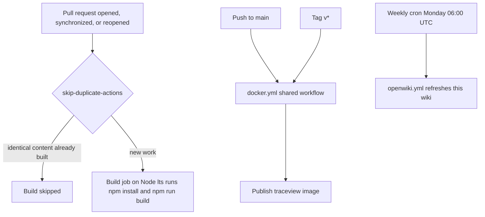

# Operations

This page covers the practical setup, validation, Docker, and CI details that matter when working in the repository, plus what the app needs from its environment at runtime.

## Local development

From `package.json` and the README:

```bash
npm install
npm run dev
```

The app runs on the Next.js dev server (`next dev`) and is expected to be opened at `http://localhost:3000`. Note that the ARDoCo backend address is runtime browser configuration rather than build configuration (see [Operational dependencies and risks](#operational-dependencies-and-risks)).

## Production build and run

From `package.json`:

```bash
npm run build
npm start
```

`next.config.ts` sets `output: 'standalone'` and `pageExtensions: ["mdx", "tsx", "ts"]`. The standalone output is the deployable artifact: `next build` emits a self-contained bundle whose entry point is `server.js`, which is exactly what the Docker image runs.

Type tooling: `tsconfig.json` compiles with `strict` enabled and maps the `@/*` import alias to `./src/*`.

## Linting

```bash
npm run lint
```

This invokes `next lint --fix` from `package.json` — it mutates files in place rather than merely reporting, which is worth keeping in mind before wiring it into any automation. The ESLint setup in `.eslintrc.json` extends `eslint-config-next` (`next/core-web-vitals` and `next/typescript`) with only two rule overrides:

- `no-console` at `error` level, allowing `console.warn` and `console.error`
- `@typescript-eslint/no-explicit-any` at `warn`

## Docker

The README documents the direct flow:

```bash
docker build -t traceview2 .
docker run -p 3000:3000 traceview2
```

The `Dockerfile` is a multi-stage build on `node:lts-alpine`:

1. **deps** — installs `libc6-compat` and runs `npm ci` against the committed lockfile (deterministic, unlike the CI build below, which uses `npm install`).
2. **builder** — copies the app and runs `npm run build` with `NEXT_TELEMETRY_DISABLED=1`.
3. **runner** — copies `public`, `.next/standalone`, and `.next/static`, creates a system user `nextjs` (uid/gid 1001), switches to it with `USER nextjs`, and runs `node server.js` with `PORT=3000` and `HOSTNAME=0.0.0.0`.

Container runs are therefore non-root on port 3000, and the image contains only the standalone server, its static assets, and `public`.

`.dockerignore` keeps `test/`, `docker-compose.yml`, `.env*`, `node_modules`, and `.next` out of the build context, so images ship neither the test fixture directory nor local compose/env overrides.

### Docker Compose

The README's Compose flow copies the checked-in template and starts it:

```bash
cp docker-compose-template.yml docker-compose.yml
docker compose up -d
```

`docker-compose-template.yml` defines a single `traceview` service that builds the local Dockerfile and tags the result as `ghcr.io/ardoco/traceview:latest` (the org-scoped name of the image CI publishes as `image-name: traceview`), publishes it only on the loopback interface (`127.0.0.1:3000:3000`), and restarts `unless-stopped`. The generated `docker-compose.yml` is gitignored ("local docker compose overrides"), so local deployment tweaks stay out of version control.

## CI/CD

Three workflows live in `.github/workflows/`, two of which delegate to the shared `ardoco/actions` repository workflows:

- **`verify.yml` ("Build")** — the gate for code changes. It triggers on pull requests (`opened`, `synchronize`, `reopened`) and manual dispatch. A `fkirc/skip-duplicate-actions@v5` pre-job (`concurrent_skipping: 'same_content_newer'`, `skip_after_successful_duplicate: 'true'`) can skip the build for duplicate content; otherwise the build job checks out the repo, installs Node `lts/*` on `ubuntu-latest`, and runs `npm install` followed by `npm run build`. There is no lint or test step in CI, so a local `npm run build` mirrors the gate exactly.
- **`docker.yml` ("Docker Push")** — on pushes to `main` and `v*` tags (plus manual dispatch), it delegates to the shared `ardoco/actions/.github/workflows/docker.yml@main` workflow with `image-name: traceview` and `push: true`; the compose template names the published image `ghcr.io/ardoco/traceview`. Pushes that only change `**.md` or `.github/**` paths skip this job.
- **`openwiki.yml` ("OpenWiki Update")** — refreshes this wiki on a weekly schedule (`cron: "0 6 * * 1"`, Mondays 06:00 UTC) via the shared `ardoco/actions` openwiki workflow, granting `contents: write` and `pull-requests: write` and passing the `OPENROUTER_API_KEY` secret. Manual dispatch is also available.

`.github/dependabot.yml` adds monthly dependency-update PRs for the `github-actions`, `npm`, and `docker` ecosystems, all using the "Dependency" commit-message prefix with scope.



*What triggers what: pull requests hit the skip-duplicate build gate, only `main` and `v*` tag pushes publish the container image, and the wiki refreshes on a weekly schedule.*

## Tests and the manual fixture

There is no unit or integration test harness: `package.json` has no `test` script, no test-runner configuration exists anywhere in the repository, and no `*.test.*` or `*.spec.*` files are present. Do not expect or add a Testing section beyond this reality — the validation practice is `npm run build` (mirroring the CI gate) plus `npm run lint` when UI code changes.

`test/test-sadsam-json.json` is the repository's only test material: a complete sample SAD_SAM `get-result` payload — top-level `requestId`, `status` (`"OK"`), `message`, `traceLinkType` (`"SAD_SAM"`), and a `traceLinks` array whose entries carry `sentenceNumber` (0-based on the wire; the parser adds 1 for display), `modelElementUid`, and `confidence`. Nothing in the source references it, and `.dockerignore` excludes `test/` from images. It serves as a manual fixture for the trace-link parse path — for example, loading it as the trace-links JSON through the `/load-project` flow exercises the stored-project viewer on realistic data without any backend.

## Operational dependencies and risks

- **A reachable ARDoCo backend is required.** The app talks to a REST backend for configuration, pipeline submission, and results; the address is runtime browser state owned by `ApiAddressContext`, defaulting to `https://rest.ardoco.de` and editable in the navbar via `EditApiAddressModal`. A candidate address is probed with `GET /api/health` through the proxy middleware and is persisted to `localStorage` only when the probe succeeds — a failed probe leaves the previously active address unchanged. The endpoint contract is documented in [ARDoCo backend API](integrations/ardoco-backend-api.md).
- **Result polling waits up to 4 minutes.** The `/view/[id]` page polls `get-result` every 5 seconds for up to 240 seconds (`pollForResult`): `ACCEPTED` keeps polling, other backend statuses surface the backend's message as an error, and on timeout the user sees "The result is still processing. Please try again later." Long-running pipelines are part of normal operation, but a run that exceeds the 4-minute budget fails UI-side even if the backend eventually completes it.
- **Project data lives in browser OPFS.** Uploaded artifacts and per-project metadata are stored in the browser's Origin Private File System (via `navigator.storage.getDirectory()` in `ClientFileStorage`), in directories keyed by the backend `requestId`; artifacts are not kept in any TraceView-owned server storage. Clearing site data therefore removes every stored project (and resets the backend address to the default). Additionally, closing a project through the navigation guard — `ConfirmNavigationModal`, wired through `NavigationContext` — immediately deletes that project's OPFS directory, as its message warns: "Navigating away will delete the current project's data from your browser." The storage contract is detailed in [Client-side project storage](architecture/client-storage.md).

## When changing operations-related code

- Run `npm run build` — it mirrors the `verify.yml` gate — and add `npm run lint` when UI code changes; remember that `lint` mutates files in place.
- Keep the README and these operations notes aligned if build, run, or Docker details change.
- Keep CI aligned with the Node/npm assumptions used locally: CI builds on Node `lts/*` and the image builds on `node:lts-alpine`, while nothing pins a Node version for local development (no `engines` or `packageManager` field in `package.json`).
- Re-run the build after touching route, context, or request-building code, since those changes can break the deployment artifact even if the UI still compiles locally.

## Related pages

- [Architecture](architecture.md) — routing, state, and the request/data flow around the operations described here.
- [ARDoCo backend API](integrations/ardoco-backend-api.md) — the endpoints the app must be able to reach at runtime.
- [Quickstart](quickstart.md) — repository orientation and the same development commands.
