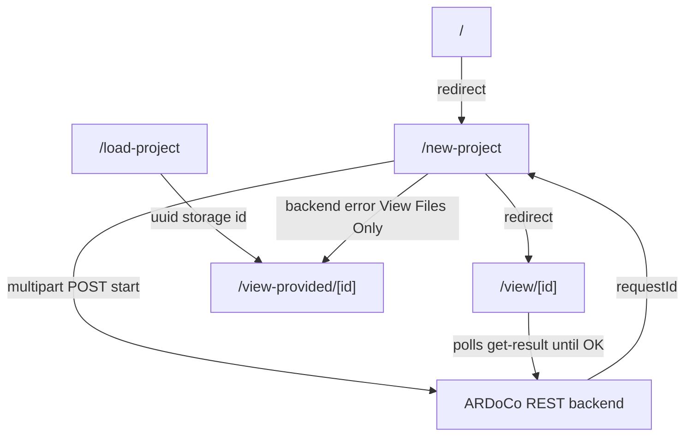

# Quickstart

ARDoCo TraceView (npm package `traceview2`) is a browser-based, installation-free frontend for [ARDoCo](https://github.com/ardoco/ardoco)'s traceability link recovery (TLR) pipelines. It is part of the [ARDoCo tool landscape](https://ardoco.de), publicly hosted at [tv.ardoco.de](https://tv.ardoco.de), and talks to the ARDoCo REST backend at `https://rest.ardoco.de` by default. Users assemble a project from software architecture documentation (SAD), an architecture model (SAM), and a code model, submit it to the backend, and explore the recovered trace links and detected inconsistencies (TEAM/MEAT) in an interactive multi-panel viewer. All ARDoCo computation happens remotely; the repository itself is a Next.js/React (TypeScript) client.

## What this repository does

- Provides the browser UI for starting and reviewing ARDoCo traceability runs — no local ARDoCo installation is required.
- Supports the four pipelines: SAD-SAM (SWATTR), SAM-Code (ArCoTL), SAD-Code (ArDoCode), and transitive SAD-SAM-Code (TransArC).
- Runs TEAM/MEAT inconsistency detection alongside trace links: in the same run for SAD-SAM (SWATTR), as a separate SAD-SAM run for the other three pipelines.
- Offers a four-step create wizard (upload files → project details → configuration → summary) and a single-step load-existing-project flow.
- Polls the backend for asynchronous results and renders trace links, documentation, architecture models, code models, and inconsistency findings side by side.
- Stores project files and metadata locally in the browser (OPFS) so results can be re-opened without the backend; projects live only in the browser and are deleted on confirmed navigation.

## Routes and flows

The Next.js App Router serves four user-facing routes; `/` is a three-line redirect — there is no landing page, and product information lives in the NavBar (About/GitHub links) and the footer.

| Route | Behavior |
| --- | --- |
| `/` | Redirects immediately to `/new-project` (`src/app/page.tsx`). |
| `/new-project` | Four-step create wizard: Upload Files → Project Details → Configuration → Summary. Its `FormProvider` excludes the `TraceLinks` and `Inconsistencies` file types from the upload slots. |
| `/load-project` | Single-step load flow that accepts all file types (including `TraceLinks`/`Inconsistencies`), stores everything locally, and never contacts the backend. |
| `/view/[id]` | Polls `GET /api/get-result/{id}` on the backend and renders the multi-panel result viewer. |
| `/view-provided/[id]` | Renders a locally stored project (files + metadata from browser storage) with no backend call. |



*Route and data-flow map: the create wizard submits to the backend and lands on `/view/[id]`; the load flow and the wizard's View-Files-Only fallback render purely from browser storage.*

The wizard carries the inconsistency outcome to `/view/[id]` in the `inconsistencies` URL parameter (`true` = same run as the trace links, a requestId = separate run, `failed`, `false`); the view page falls back to the request id stored in the project's OPFS metadata when the parameter is absent. See [Workflows](workflows.md) and [ArDoCo backend API](integrations/ardoco-backend-api.md).

## Wiki page map

| Page | Covers |
| --- | --- |
| [Architecture](architecture.md) | Hub page: app shell and routing, React context state, the `/api/*` proxy rewrite, and the runtime data flow from upload through polling to multi-panel rendering. |
| [Project forms and wizard](architecture/project-forms.md) | The `multiStepForm` subsystem: the `Step` contract, `FormValidation` rules, file-type preselection, the three-source Configuration step, and the error modal family. |
| [Result viewer](architecture/result-viewer.md) | The `traceLinksResultViewer` subsystem: panel layout and chrome, the five view modules (documentation, architecture model, code model, tracelinks, inconsistencies) with parsers and data models, OPFS-backed data loading, and export buttons. |
| [Cross-panel highlighting](architecture/highlighting.md) | The two highlight contexts, matching semantics per `DisplayOption`, `MessageSource`/timestamp arbitration, and the click paths that propagate selection across all viewer panels. |
| [Client-side project storage](architecture/client-storage.md) | OPFS layout per project, `project.meta.json` conventions, the shared `"Architecture Model"` stored name, load/delete semantics, and the navigation guard that deletes stored projects and aborts in-flight requests. |
| [Domain model](domain.md) | Artifact/file types, the four pipeline combinations and their required inputs, trace-link and inconsistency models, the `traceLinkConfiguration` object, and project identity. |
| [Workflows](workflows.md) | End-to-end journeys with verified control flow: create wizard, load-existing-project, backend result polling, the locally stored view-provided path, and project cleanup on navigation. |
| [ARDoCo backend API](integrations/ardoco-backend-api.md) | The backend boundary: the `X-Target-API` proxy middleware, the full endpoint catalog (pipeline start, find-inconsistencies, get-result, configuration, health), multipart payload contracts, and API address management. |
| [Operations](operations.md) | Development, build, lint, Docker, and CI practice, including the no-test-harness reality, the fixture, and operational dependencies on the configured ARDoCo backend. |

## Best starting points in source

- `src/app/layout.tsx` — app shell: `NavBar` plus the global `ApiAddressProvider`/`NavigationProvider` wrappers every route inherits, and the ardoco.de font pair.
- `src/app/page.tsx` — the three-line redirect from `/` to `/new-project`.
- `src/proxy.ts` — the app-wide `/api/*` rewrite onto the configured ARDoCo backend.
- `src/util/ArdocoApi.tsx` — request construction and validation for pipeline submissions.
- `src/app/view/[id]/page.tsx` — result polling and result-viewer bootstrap.

## Task routing

| Change area or intent | Wiki page | Source entry points | Important symbols / types | Focused tests | Minimal validation |
| --- | --- | --- | --- | --- | --- |
| Add or change a trace-link pipeline / request payload | [Domain model](domain.md), [ARDoCo backend API](integrations/ardoco-backend-api.md) | `src/util/ArdocoApi.tsx`, `src/components/dataTypes/TraceLinkTypes.tsx` | `TraceLinkTypes`, `fetchArdocoApi` | none (build-only) | `npm run build` |
| Change wizard steps, validation, or file-type preselection | [Project forms and wizard](architecture/project-forms.md), [Workflows](workflows.md) | `src/components/multiStepForm/MultiStepFormNewProject.tsx`, `src/components/multiStepForm/FormValidation.tsx`, `src/contexts/ProjectUploadContext.tsx` | `Step`, `FormValidation`, `FormProvider` | none (build-only) | `npm run build && npm run lint` |
| Change end-to-end flows (create, load, inconsistency runs) | [Workflows](workflows.md) | `MultiStepFormNewProject.tsx`, `MultiStepFormLoadProject.tsx`, `src/app/view/[id]/page.tsx` | `inconsistenciesParam`, `InconsistencySource` | none (build-only) | `npm run build` |
| Change result polling / result lifecycle | [Workflows](workflows.md), [ARDoCo backend API](integrations/ardoco-backend-api.md) | `src/app/view/[id]/page.tsx` | `pollForResult`, `OK`/`ACCEPTED` status contract, `NavigationContext` | none (build-only) | `npm run build` |
| Add or modify a result viewer panel or parser | [Result viewer](architecture/result-viewer.md) | `src/components/traceLinksResultViewer/ResultDisplay.tsx`, `views/*` | `ViewProps` (`views/ViewProps.tsx`), `DisplayOption` | none (build-only) | `npm run build` |
| Change cross-panel highlighting or the results toast | [Cross-panel highlighting](architecture/highlighting.md) | `src/contexts/HighlightTracelinksContextType.tsx`, `src/contexts/HighlightInconsistencyContext.tsx` | `HighlightProvider`, `InconsistencyProvider`, `MessageSource` | none (build-only) | `npm run build` |
| Change client-side storage or project cleanup | [Client-side project storage](architecture/client-storage.md) | `src/util/ClientFileStorage.tsx`, `src/contexts/NavigationContext.tsx` | `storeProjectFiles`, `loadProjectFile`, `deleteProjectDirectory` | none (build-only) | `npm run build` |
| Change the backend proxy, endpoints, or API address handling | [ARDoCo backend API](integrations/ardoco-backend-api.md) | `src/proxy.ts`, `src/contexts/ApiAddressContext.tsx` | `proxy` (matcher `/api/:path*`), `X-Target-API`, `ApiAddressProvider` | none (build-only) | `npm run build` |
| Change global client state or the app shell | [Architecture](architecture.md) | `src/app/layout.tsx`, `src/contexts/*.tsx` | `ApiAddressProvider`, `NavigationProvider`, `FormProvider` | none (build-only) | `npm run build` |
| Change routing or build configuration | [Architecture](architecture.md), [Operations](operations.md) | `next.config.ts`, `src/app/**/page.tsx` | `pageExtensions`, `output: 'standalone'` | none (build-only) | `npm run build` |
| Change build, lint, Docker, or CI | [Operations](operations.md) | `package.json`, `Dockerfile`, `.github/workflows/*` | npm scripts (`dev`, `build`, `start`, `lint`) | `verify.yml` build job | `npm run build` |

## Repository shape

- `src/app/` — Next.js App Router routes: `/` (redirect), `/new-project`, `/load-project`, `/view/[id]`, and `/view-provided/[id]`.
- `src/components/` — forms (`multiStepForm/`), the result viewer (`traceLinksResultViewer/`), shared UI (`NavBar`, `Footer`, `EditApiAddressModal`, the error/confirm modals), and shared `dataTypes/` (`FileType`, `TraceLinkTypes`, `DisplayOption`, `MessageSource`, `UploadedFile`).
- `src/contexts/` — client-side state providers: API address, navigation guard, upload form state, and the two highlight contexts.
- `src/util/` — backend request building (`ArdocoApi.tsx`), OPFS storage (`ClientFileStorage.tsx`), `useDataLoader`, and a download helper.
- `.github/workflows/` — build verification on pull requests (`verify.yml`), Docker image push (`docker.yml`), and the weekly OpenWiki refresh (`openwiki.yml`).
- `test/` — a single SAD-SAM result JSON fixture (`test-sadsam-json.json`) used as a sample get-result payload; there is no test harness.

## Development commands

From `package.json`:

```bash
npm install
npm run dev      # next dev, serves http://localhost:3000
npm run build    # next build (emits the standalone output)
npm run start    # next start, serves the production build
npm run lint     # eslint --fix (flat config in eslint.config.mjs)
```

## CI and deployment

- `verify.yml` ("Build") runs on pull requests and manual dispatch. A `skip-duplicate-actions` pre-job skips unchanged re-runs; the build job installs dependencies, runs `npx eslint .`, and `npm run build` on Node `lts/*`.
- `docker.yml` pushes the `traceview` image on pushes to `main` (ignoring markdown and `.github` changes) and on `v*` tags via the reusable ardoco Docker workflow.
- The `Dockerfile` is a three-stage build (deps → builder → runner): `npm ci`, one `npm run build` with `output: 'standalone'`, then a non-root runtime serving the standalone `server.js` on port 3000.
- `docker-compose-template.yml` provides a compose file for `ghcr.io/ardoco/traceview:latest` publishing `127.0.0.1:3000`; the public instance runs at [tv.ardoco.de](https://tv.ardoco.de).
- `openwiki.yml` refreshes the generated `openwiki/` pages weekly (Mondays 06:00 UTC) via the reusable ardoco OpenWiki workflow.

## Notes for future changes

- Traceability pipeline behavior is centralized in `src/util/ArdocoApi.tsx`: the endpoint comes from the trace-link type's lowercased `api_name`, find-inconsistencies runs as a single call restricted to SAD-SAM (SWATTR), and the other pipelines get a separate SAD-SAM inconsistency run. Change request payload rules there first.
- The result page polls until the backend answers `OK` and treats only `ACCEPTED` as still-running; result-handling changes must preserve that accepted/polling contract in `src/app/view/[id]/page.tsx`, including the separate polling of a standalone inconsistency run.
- All backend traffic flows through the `X-Target-API` rewrite in `src/proxy.ts`; the repository defines no local API route handlers.
- File-type and pipeline-combination rules live in `FormValidation` and the `TraceLinkTypes` `checkCondition` predicates, which treat PCM and UML as one logical architecture-model slot — see [Domain model](domain.md).
- Projects exist only in the browser: confirming navigation away deletes the project's OPFS directory and aborts in-flight requests, so no server-side project cleanup exists to maintain.
- The repository runs Next.js 16 / React 19; `AGENTS.md` carries a generated block reminding contributors to read the bundled Next.js docs (`node_modules/next/dist/docs/`) before writing code, because APIs may differ from older Next.js knowledge.
- Per `AGENTS.md`, the generated `openwiki/` wiki is optional just-in-time context — not required startup reading — and this page is the documented fallback entry point when the OpenWiki retrieval tools are unavailable.
