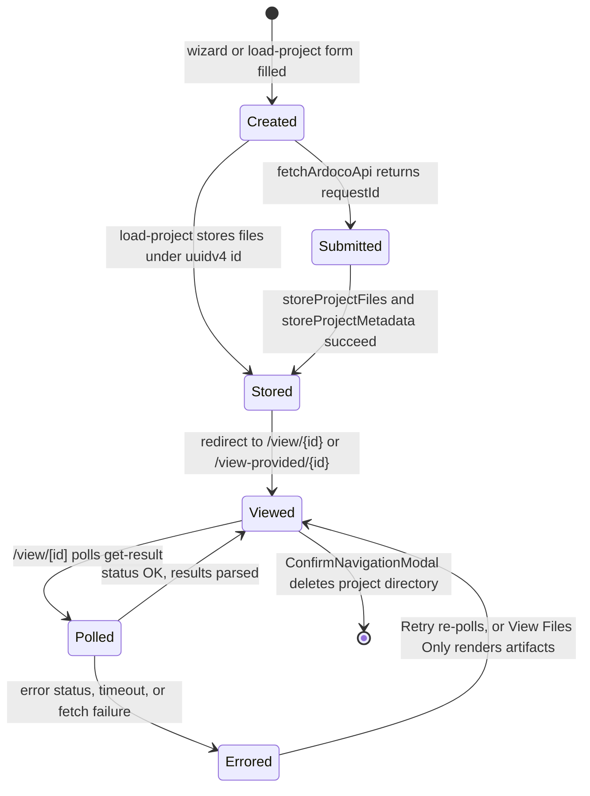
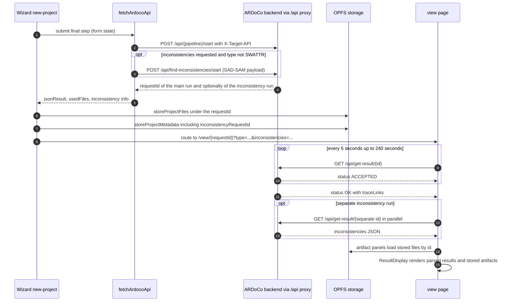
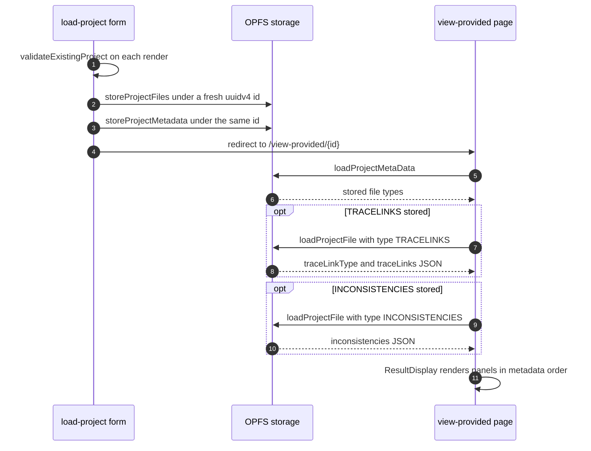

# Workflows

TraceView's user journeys revolve around one question: where does the result come from? A project either runs through the ARDoCo backend (create wizard → poll → result viewer) or is viewed purely from locally stored files (load-project → stored-project viewer). All journeys share one lifecycle: a project id is registered in `NavigationContext`, and leaving the project deletes its locally stored data after a confirmation dialog.

The journeys are:

1. **Enter the app** — the root route redirects straight into the create wizard (`/` → `/new-project`); the nav bar reaches both forms.
2. **Create a project** — four-step wizard submitting one or two runs to the ARDoCo backend (`/new-project`).
3. **Load an existing result** — single-step upload of stored artifacts, including trace-link and inconsistency JSON (`/load-project`).
4. **View a backend run** — poll `/api/get-result/{id}` until the pipeline finishes (`/view/[id]`).
5. **View a locally stored project** — parse stored files with no backend involvement (`/view-provided/[id]`).
6. **Leave a project** — confirmation, local cleanup, and request abortion.

## 1. Entry points: redirect and nav bar

There is no landing page. The root route (`src/app/page.tsx`) renders nothing but a server `redirect("/new-project")` — the app starts directly in the create wizard, and product information lives in the nav bar and footer instead.

The nav bar (`src/components/NavBar.tsx`) offers **New Project** (`/new-project`), **Load Project** (`/load-project`), and the external **About** and **GitHub** links. All three navigation surfaces — the desktop links, the mobile menu dialog, and the ARDoCo logo — route their clicks through `NavigationContext.handleNavigation`, so the leave-project guard described in section 6 applies everywhere; the mobile handler only additionally closes the menu before delegating.

## 2. Creating a project: the four-step wizard

`src/app/new-project/page.tsx` wraps `MultiStepFormNewProject` in `FormProvider` and restricts `allowedFileTypes` to every `FileType` **except** `TRACELINKS` and `INCONSISTENCIES` — result files cannot enter a backend submission. The wizard itself is documented component-by-component in [Project forms and wizard](architecture/project-forms.md); the journey-relevant flow is:

1. **Upload Files** — drag-and-drop with automatic file-type preselection by extension (`.uml` → UML model, `.repository` → PCM, `.txt` → documentation, `.acm` → code model; a `.json` file only preselects a result type if that type is allowed, which it never is on this route).
2. **Project Details** — project name, trace-link type selection, and the find-inconsistencies checkbox. A trace-link type is selectable only when its `checkCondition` passes against the uploaded files, and the checkbox is disabled unless the files contain documentation plus an architecture model (`canFindInconsistencies`) — inconsistency detection needs exactly those two inputs for every pipeline.
3. **Configuration** — adjust the ARDoCo trace-link configuration. The defaults come from `GET /api/configuration` fetched by `FormProvider` on mount (and whenever the API address changes), exposed as `configurationLoading`/`configurationError`; the step offers three sources: defaults, a JSON file upload, or manual input.
4. **Summary** — review the provided data (name, type, inconsistency flag, files, effective configuration) before calculating trace links.

### Step validation gating

Each step object carries a `validation()` function from `FormValidation` (`src/components/multiStepForm/FormValidation.tsx`), and the current step's errors are rendered inline via `DisplayErrors`. Two gates protect the flow:

- **Step navigation.** A step can be selected in the `Stepper` only if it lies before the current step, or if the user already reached it and every preceding step currently validates (`isStepReachable`). **Next** is disabled while the current step has errors.
- **Summary re-validation.** The summary step re-runs the file and details validations and reports which steps need fixing ("You need to resolve the issue at step 1 …"), and the **Calculate Trace Links** button is disabled while summary errors exist or a submission is in flight.

The file rules are: at least two files with a type for each, at most one file per type except architecture models (at most one PCM/UML combined); the details rules are a project name plus a selected trace-link type.

### Submission: single or paired backend runs

On the final step, `handleSubmit`:

1. Calls `fetchArdocoApi` (`src/util/ArdocoApi.tsx`) with the form state. It builds the multipart payload per pipeline — `projectName`, an `additionalConfigs` JSON field (empty-string values filtered out), and the type-specific `inputCode` / `inputText` / `inputArchitectureModel` fields plus `inputArchitectureModelFormat` (the PCM/UML discriminant) — and POSTs to `/api/{api_name lowercased}/start` (e.g. `/api/transarc/start` for TransArC), or directly to `/api/find-inconsistencies/start` when SWATTR runs with inconsistency detection. A response without a `requestId` is rejected, and the files actually sent (`usedFiles`) are returned for local storage.
2. **Inconsistency detection works for every pipeline, not just SWATTR.** For SWATTR the inconsistencies are part of the same run. For any other trace-link type, `fetchArdocoApi` starts the main run **and** a separate SAD-SAM inconsistency run (same documentation, architecture model, and configuration) via `Promise.allSettled`: if the main run fails the error propagates; if only the inconsistency run fails, the result carries an `inconsistencyError` instead of an `inconsistencyRequestId`; and the documentation and architecture model are always added to `usedFiles` so the result view can display the inconsistencies.
3. Stores the used files plus metadata for **all** uploaded files in the browser (OPFS) under the returned `requestId` via `storeProjectFiles` and `storeProjectMetadata` — the metadata additionally records the inconsistency run's `inconsistencyRequestId` (the storage contract is detailed in [Client-side project storage](architecture/client-storage.md)).
4. Redirects to `/view/{encodedRequestId}?type={traceLinkTypeName}&inconsistencies={param}`, where `param` is computed by the wizard's `inconsistenciesParam` helper: `"failed"` when the separate inconsistency run could not start, `"false"` when none was requested, `"true"` when it shares the trace-link request id (SWATTR), otherwise the separate run's id.

The result page needs both query parameters: `type` selects the trace-link type and its panel options, `inconsistencies` decides where the inconsistencies panel's data comes from.

### Failure paths in the wizard

- **API failure** — if `fetchArdocoApi` throws, a `LoadingErrorModal` appears ("An error occurred while processing your request. Please try again."). **Retry** simply closes the modal so the user can resubmit via the button. **View Files Only** stores the still-uploaded files under a fresh `uuidv4` id and redirects to `/view-provided/{id}`, so the artifacts remain inspectable without a backend result; if that storage write fails, the storage-error modal appears instead.
- **Storage failure** — if writing the backend run's files or metadata to browser storage fails, a separate single-button modal (`ErrorModalFileUpload`, "An error occurred while uploading the files. Please try again.") appears with only an **Okay** button, returning the user to the wizard.

## 3. Loading a provided project

`/load-project` (`src/app/load-project/page.tsx`) wraps `MultiStepFormLoadProject` (`src/components/multiStepForm/MultiStepFormLoadProject.tsx`) in `FormProvider` with **all** `FileType` values allowed — including `TRACELINKS` and `INCONSISTENCIES` result JSON. It is a single-step wizard ("Upload Files", titled "Upload the Project Files and Trace Links") validated by `FormValidation.validateExistingProject`: at least one file, no more than one file per type, and at most one architecture model (PCM/UML combined).

On **Visualize Trace Links**, the flow generates a `uuidv4` storage id and calls `storeProjectFiles` and `storeProjectMetadata`. Storage errors are only logged — `handleSubmit` still returns the id, so the redirect to `/view-provided/{encodedId}` proceeds even when nothing was persisted; the missing project directory then surfaces as the viewer's load-failure banner. The **Exit** button on the only step routes back to `/new-project`, not to a landing page.

## 4. Viewing a backend run: `/view/[id]`

`src/app/view/[id]/page.tsx` owns the asynchronous backend run.

### The query-parameter contract

The wizard's redirect defines the page's inputs: `type` is resolved via `getTraceLinkTypeByName` (falling back to the `SAD_SAM_CODE` entry, TransArC) and `inconsistencies` is decoded by `toInconsistencySource` into one of four states — **none** (`false`/absent value), **same** (`true` or equal to the trace-link request id, i.e. SWATTR's combined run), **failed** (the separate run could not be started), or **separate** (the parameter holds the inconsistency run's id). When the parameter is absent entirely — e.g. projects stored by older builds — the page falls back to the `inconsistencyRequestId` recorded in the stored project metadata (`loadInconsistencyRequestId`).

### Polling: `pollForResult`

The helper `pollForResult` GETs `/api/get-result/{id}` (with the `X-Target-API` header) **every 5 seconds for up to 240 seconds**:

- `status: "OK"` returns the payload.
- `status: "ACCEPTED"` keeps polling.
- Any other status throws an error carrying the backend's `message` verbatim ("An error occurred while running the pipeline in ARDoCo: \n …").
- On timeout it throws "The result is still processing. Please try again later."

Each polling effect owns a **local** `AbortController` that is aborted when the component unmounts (or when the effect re-runs), so a completed navigation ends polling silently — `AbortError`s are swallowed, and an aborted (superseded) run never touches the state of the run that replaced it. **Retry** in the error modal starts yet another fresh local controller. The shared `AbortController` that `NavigationContext` still aborts and resets on a confirmed leave is no longer the signal driving these polls; cancellation on leave effectively happens through the unmount cleanup that fires when the route changes (see [Client-side project storage](architecture/client-storage.md)).

### Display options

`displayOptions` start as a copy of the trace-link type's `resultViewOptions` (e.g. Code Model, Architecture Model, Documentation for TransArC — see [Domain model](domain.md)). `DisplayOption.TRACELINKS` is **always unshifted first**. Whenever inconsistencies are shown, `ARCHITECTURE_MODEL` and `DOCUMENTATION` are ensured to be present (inconsistencies refer to exactly those two artifacts) and `DisplayOption.INCONSISTENCIES` is appended last.

### The separate inconsistency run

When the inconsistency source is a separate run, the page polls `/api/get-result/{separateRequestId}` in parallel with the trace-link run, under its own local `AbortController`. Its outcome is keyed by `apiAddress|requestId` so the "loading" and "error" states of the inconsistencies panel are derived during render; only its inconsistencies are used — the SAD-SAM trace links of that run are ignored. A `failed` source surfaces the static error "Could not start the inconsistency detection." in the inconsistencies panel without blocking the trace-link panels.

### Success, registration, and errors

While waiting, a "Generating trace links, please wait..." banner is shown. On success the page parses `response.result.traceLinks` with `parseTraceLinksFromJSON` (using the backend's reported trace-link type for parsing) and — whenever the result contains them — `response.result.inconsistencies` into the same-run pool, then renders `ResultDisplay` inside `HighlightProvider` and `InconsistencyProvider`. Note the split data source: the backend result contains only trace-link (and optionally inconsistency) JSON; the artifact panels load their files from the OPFS directory stored at submission time.

The page registers the decoded project id in `NavigationContext` on mount and clears it on unmount. Any polling error opens `LoadingErrorModal` with two options: **Retry** re-polls, and **View Files Only** clears the error and stops loading, rendering the panels **without** parsed trace links (the artifact panels still work from OPFS storage).

## 5. Viewing a locally stored project: `/view-provided/[id]`

`src/app/view-provided/[id]/page.tsx` reconstructs a result purely from browser storage — there is no backend involvement:

1. `loadProjectMetaData` reads `project.meta.json` and returns the stored file types.
2. `displayOptions` are derived from those types via `getResultViewOption` (so a stored project yields exactly the panels matching its stored files, in metadata order).
3. If a `TRACELINKS` file is stored, its JSON (`traceLinkType` + `traceLinks`) is parsed; the trace-link type falls back to `SAD_SAM_CODE` when unknown or absent. If an `INCONSISTENCIES` file is stored, its `inconsistencies` array is parsed likewise.
4. Parse or load failures surface as a banner ("Failed to load data: …") with **no retry option** (`retryAllowed={false}`).

Like `/view/[id]`, the page registers the decoded project id in `NavigationContext` on mount — but there is **no** unmount cleanup. The result is then rendered through the same `ResultDisplay`/`HighlightProvider`/`InconsistencyProvider` stack (see [Result viewer](architecture/result-viewer.md)).

## 6. Leaving a project

`NavigationContext` (`src/contexts/NavigationContext.tsx`) owns the leave-project lifecycle. When a `currentProjectId` is set, `handleNavigation` (used by the nav bar's desktop links, its mobile menu dialog, and the logo) stores the target path and opens `ConfirmNavigationModal`, which warns: "Navigating away will delete the current project's data from your browser. Are you sure you want to continue?" Confirming then, in order:

1. Deletes the project's OPFS directory via `deleteProjectDirectory` (the deleted data is gone permanently — see [Client-side project storage](architecture/client-storage.md)),
2. Clears the current project id,
3. Aborts the shared `AbortController` (with reason "User is leaving the page or navigating away.") and resets it with a fresh controller for future use,

and only then pushes the stored path via the router. Cancelling closes the modal without any cleanup.

## Project lifecycle

*Project lifecycle: a project is created in a form, submitted and stored (or stored directly by load-project), viewed through polling or local parsing, and deleted from browser storage when the user confirms leaving.*

## Submit → poll → render

*Submission-to-result flow: the wizard posts the project (plus an optional separate inconsistency run), stores the artifacts locally under the returned request id, and the result page polls until the backend answers OK; the final view combines the parsed result JSON with the locally stored artifact files.*

## Load → store → parse

*Load-provided flow: the form persists the uploaded files under a generated id, and the viewer reconstructs the result entirely from OPFS — metadata order drives the panels, and stored JSON supplies trace links and inconsistencies with no backend call.*

## Things to watch when changing workflows

- **Query-parameter contract.** The wizard redirects to `/view/{id}?type=...&inconsistencies=...`; the result page reads exactly these parameters, and `inconsistencies` is four-valued (`true`, a separate run id, `failed`, `false`). Changing names, encoding, or the fallback type breaks the panel selection; removing the parameter silently switches the page to the stored-metadata fallback.
- **Inconsistency availability is file-gated, not pipeline-gated.** `canFindInconsistencies` (documentation plus architecture model) drives both the disabled state of the checkbox and the automatic reset in `ProjectUploadContext.updateFormData`, while `fetchArdocoApi` decides same-run versus separate-run execution by trace-link type. Keep the UI gating, the paired-run logic, and the result-view's four source states aligned.
- **Step validation must stay aligned with wizard copy.** Each step's `validation()` in `FormValidation` (and `validateExistingProject` for load-project) is what the stepper actually enforces; if step order, rules, or messages change, update both the validation functions and the explanatory copy in [Quickstart](quickstart.md).
- **Abort semantics moved.** Polling controllers are local to `/view/[id]`'s effects and cancelled via unmount cleanup; the shared `NavigationContext` abort-and-reset survives but currently has no active consumer (the only nominal consumer, view-provided's error banner, renders no Retry button). If you reintroduce shared-signal polling, preserve the distinction between initial mount, retry, and the separate-run effect.
- **Panel ordering differs between the two result routes.** `/view/[id]` always places `TRACELINKS` first and appends `INCONSISTENCIES` last (ensuring the two artifact panels inconsistencies refer to); `/view-provided/[id]` derives options from stored metadata order instead.
- **load-project storage failures are silent.** The viewer redirect happens even when the OPFS writes failed; only the viewer's error banner will tell the user. Make new failure paths explicit rather than copying this pattern.
