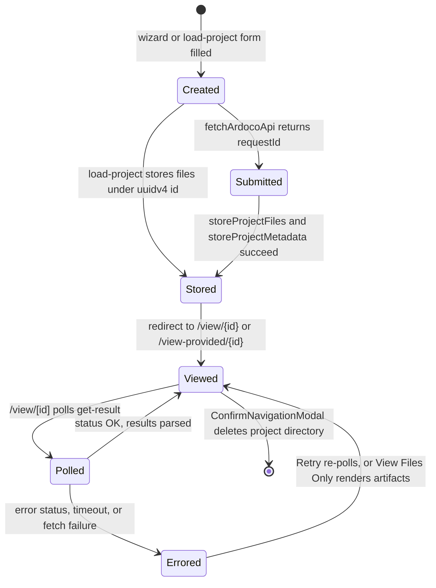
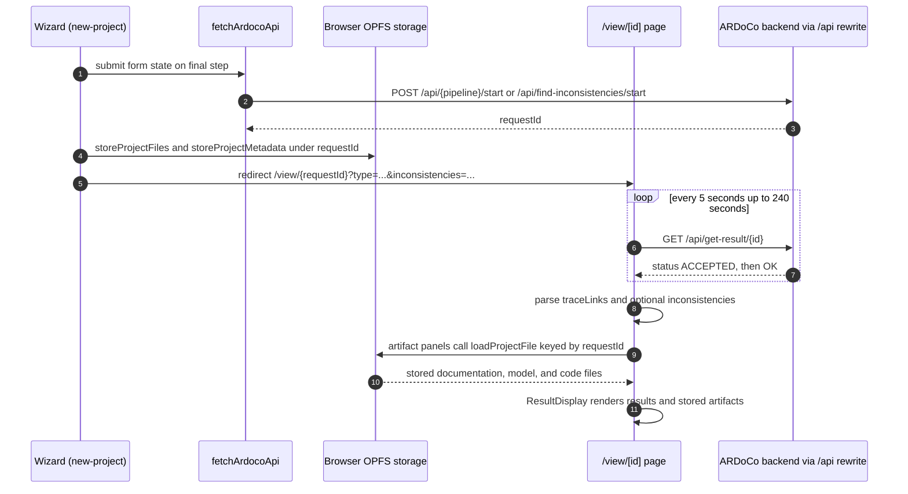

# Workflows

TraceView's user journeys revolve around one question: where does the result come from? A project either runs through the ARDoCo backend (create wizard → poll → result viewer) or is viewed purely from locally stored files (load-project → stored-project viewer). All journeys share one lifecycle: a project id is registered in `NavigationContext`, and leaving the project deletes its locally stored data after a confirmation dialog.

The five journeys are:

1. **Create a project** — four-step wizard submitting to the ARDoCo backend (`/new-project`).
2. **Load an existing result** — single-step upload of stored artifacts, including trace-link and inconsistency JSON (`/load-project`).
3. **View a backend run** — poll `/api/get-result/{id}` until the pipeline finishes (`/view/[id]`).
4. **View a locally stored project** — parse stored files with no backend involvement (`/view-provided/[id]`).
5. **Leave a project** — confirmation, local cleanup, and request abortion.

## 1. Landing page and entry points

The landing page `/` (`src/app/page.tsx`) introduces ARDoCo TraceView and routes users into the wizard through its primary **Start** button, a link to `/new-project`. The nav bar additionally offers **New Project** (`/new-project`) and **Load Project** (`/load-project`). Desktop navigation (and the logo) is intercepted through `NavigationContext.handleNavigation`, so the leave-project guard described below applies to nav clicks; the mobile menu dialog uses plain anchors and is not intercepted.

## 2. Creating a project: the four-step wizard

`src/app/new-project/page.tsx` wraps `MultiStepFormNewProject` in `FormProvider` and restricts `allowedFileTypes` to every `FileType` **except** `TRACELINKS` and `INCONSISTENCIES` — result files cannot be part of a backend submission. `src/components/multiStepForm/MultiStepFormNewProject.tsx` implements the four steps:

1. **Upload Files** — drag-and-drop with automatic file-type preselection by extension (`.uml` → UML model, `.repository` → PCM, `.txt` → documentation, `.acm` → code model; a `.json` file only preselects a result type if that type is allowed, which it never is on this route).
2. **Project Details** — project name, trace-link type selection, and the find-inconsistencies checkbox.
3. **Configuration** — adjust the ARDoCo trace-link configuration; the defaults are fetched from `/api/configuration` by `FormProvider` on mount (and whenever the API address changes), exposed as `configurationLoading`/`configurationError`.
4. **Summary** — review the provided data before calculating trace links.

### Step validation gating

Each step object carries a `validation()` function from `FormValidation` (`src/components/multiStepForm/FormValidation.tsx`), and the current step's errors are rendered inline via `DisplayErrors`. The wizard cannot be advanced past invalid data: the summary step re-validates the earlier steps and reports which steps need fixing ("You need to resolve the issues at steps …"), and the **Calculate TraceLinks** button is disabled while summary errors exist. The rules are: at least two files with a type for each, at most one file per type except architecture models (at most one PCM/UML combined), and a project name plus selected trace-link type.

### Submission and local storage

On the final step, `handleSubmit`:

1. Calls `fetchArdocoApi` (`src/util/ArdocoApi.tsx`) with the form state. It builds the multipart payload per pipeline — `projectName`, an `additionalConfigs` JSON field (empty values filtered out), and the type-specific `inputCode` / `inputText` / `inputArchitectureModel` fields plus `inputArchitectureModelFormat` (the PCM/UML discriminant) — and POSTs to `/api/{api_name lowercased}/start` (e.g. `/api/transarc/start` for TransArC), or to `/api/find-inconsistencies/start` when `findInconsistencies` is set. Inconsistency detection is only permitted for `SAD_SAM`; any other type throws. A response without a `requestId` is rejected, and the files actually sent (`usedFiles`) are returned for local storage.
2. Stores the used files plus metadata for all uploaded files in the browser (OPFS) under the returned `requestId` via `storeProjectFiles` and `storeProjectMetadata` (`src/util/ClientFileStorage.tsx`; the storage contract is detailed in [Client-side project storage](architecture/client-storage.md)).
3. Redirects to `/view/{encodedRequestId}?type={traceLinkTypeName}&inconsistencies={true|false}`.

The result page needs both query parameters: `type` selects the trace-link type and its panel options, `inconsistencies` decides whether the inconsistencies panel is added.

### Failure paths in the wizard

- **API failure** — if `fetchArdocoApi` throws, a `LoadingErrorModal` appears ("An error occurred while processing your request. Please try again."). **Retry** simply closes the modal so the user can resubmit via the button. **View Files Only** re-runs `handleSubmit` (storing whatever succeeded under the request id) and redirects to `/view-provided/{requestId}`, so the artifacts remain inspectable without a backend result.
- **Storage failure** — if writing to browser storage fails, a separate single-button modal ("An error occurred while uploading the files. Please try again.") appears with only an **Okay** button, returning the user to the wizard.

## 3. Loading a provided project

`/load-project` (`src/app/load-project/page.tsx`) wraps `MultiStepFormLoadProject` (`src/components/multiStepForm/MultiStepFormLoadProject.tsx`) in `FormProvider` with **all** `FileType` values allowed — including `TRACELINKS` and `INCONSISTENCIES` result JSON. It is a single-step wizard ("Upload Files") validated by `FormValidation.validateExistingProject`: at least one file, no more than one file per type, and at most one architecture model (PCM/UML combined).

On **Visualize TraceLinks**, the flow generates a `uuidv4` storage id, calls `storeProjectFiles` and `storeProjectMetadata`, and redirects to `/view-provided/{encodedId}`. Storage errors are logged, not surfaced as a modal; the redirect proceeds regardless. The **Exit** button on the only step returns to `/`.

## 4. Viewing a backend run: `/view/[id]`

`src/app/view/[id]/page.tsx` owns the asynchronous backend run. The route's query parameters form a strict contract with the wizard redirect: `type` (matched via `getTraceLinkTypeByName`, falling back to `SAD_SAM_CODE`) and `inconsistencies=true` (anything else is treated as false).

### Display options

`displayOptions` start as a copy of the trace-link type's `resultViewOptions` (e.g. Code Model, Architecture Model, Documentation for TransArC — see [Domain model](domain.md)). `DisplayOption.TRACELINKS` is **always unshifted first**, and `DisplayOption.INCONSISTENCIES` is **appended only when the query parameter requested them**.

### Polling: `pollForResult`

The helper `pollForResult` GETs `/api/get-result/{id}` (with the `X-Target-API` header) **every 5 seconds for up to 240 seconds**:

- `status: "OK"` returns the payload.
- `status: "ACCEPTED"` keeps polling.
- Any other status throws an error carrying the backend's `message` verbatim ("An error occurred while running the pipeline in ardoco: \n …").
- On timeout it throws "The result is still processing. Please try again later."

The initial poll uses the shared `AbortController` from `NavigationContext`, so a confirmed leave aborts it; `fetchResult` swallows `AbortError`s, ending polling silently. **Retry** in the error modal, however, creates a fresh local `AbortController`, so a retried poll is no longer cancellable by a later confirmed leave (see [Client-side project storage](architecture/client-storage.md) for the abort semantics in detail).

While waiting, a "Generating Trace-Links, please wait…" banner is shown. On success the page parses `response.result.traceLinks` with `parseTraceLinksFromJSON` and — only when the query parameter requested them and they are present — `response.result.inconsistencies` with `parseInconsistenciesFromJSON`, then renders `ResultDisplay` inside `HighlightProvider` and `InconsistencyProvider`. Note the split data source: the backend result contains only trace-link (and optionally inconsistency) JSON; the artifact panels load their files from the OPFS directory stored at submission time.

### Registration and errors

The page registers the decoded project id in `NavigationContext` on mount and clears it on unmount. Any polling error opens `LoadingErrorModal` with two options: **Retry** re-polls, and **View Files Only** clears the error and stops loading, rendering the panels **without** parsed trace links (the artifact panels still work from OPFS storage).

## 5. Viewing a locally stored project: `/view-provided/[id]`

`src/app/view-provided/[id]/page.tsx` reconstructs a result purely from browser storage — there is no backend involvement:

1. `loadProjectMetaData` reads `project.meta.json` and returns the stored file types.
2. `displayOptions` are derived from those types via `getResultViewOption` (so a stored project with only documentation, a model, and trace links yields exactly those panels, in metadata order).
3. If a `TRACELINKS` file is stored, its JSON (`traceLinkType` + `traceLinks`) is parsed; the trace-link type falls back to `SAD_SAM_CODE` when unknown or absent. If an `INCONSISTENCIES` file is stored, `inconsistencies` is parsed likewise.
4. Parse failures surface as a banner ("Failed to load data: …") with **no retry option** (`retryAllowed={false}`).

Like `/view/[id]`, the page registers the decoded project id in `NavigationContext` on mount (there is no unmount cleanup). The result is then rendered through the same `ResultDisplay`/`HighlightProvider`/`InconsistencyProvider` stack.

## 6. Leaving a project

`NavigationContext` (`src/contexts/NavigationContext.tsx`) owns the leave-project lifecycle. When a `currentProjectId` is set, `handleNavigation` (used by the nav bar and logo) stores the target path and opens `ConfirmNavigationModal`, which warns: "Navigating away will delete the current project's data from your browser." Confirming then, in order:

1. Deletes the project's OPFS directory via `deleteProjectDirectory` (the deleted data is gone permanently — see [Client-side project storage](architecture/client-storage.md)),
2. Clears the current project id,
3. Aborts the shared `AbortController` (ending any in-flight polling) and resets it with a fresh controller for future requests,

and only then pushes the stored path via the router. Cancelling closes the modal without any cleanup.

## Project lifecycle

*Project lifecycle: a project is created in a form, submitted and stored (or stored directly by load-project), viewed through polling or local parsing, and deleted from browser storage when the user confirms leaving.*

## Submit → poll → render

*Submission-to-result flow: the wizard posts the project, stores the artifacts locally under the returned request id, and the result page polls until the backend answers OK; the final view combines the parsed result JSON with the locally stored artifact files.*

## Things to watch when changing workflows

- **Query-parameter contract.** The wizard redirects to `/view/{id}?type=...&inconsistencies=...`; the result page reads exactly these parameters. Changing names, encoding, or the fallback type breaks the panel selection.
- **Inconsistency detection is restricted to SAD_SAM.** `fetchArdocoApi` throws for any other pipeline, and `ProjectUploadContext.updateFormData` automatically resets `findInconsistencies` to `false` whenever the selected trace-link type is not `SAD_SAM`. Keep both the backend restriction and the UI reset aligned.
- **Step validation must stay aligned with wizard copy.** Each step's `validation()` in `FormValidation` (and `validateExistingProject` for load-project) is what the stepper actually enforces; if step order, rules, or messages change, update both the validation functions and the explanatory copy on the home page and [Quickstart](quickstart.md).
- **Retry is not abortable.** The error-modal **Retry** path swaps in a local `AbortController`; a leave-project abort only cancels the initial poll. If you change polling lifecycle handling, preserve this distinction deliberately.
- **Panel ordering differs between the two result routes.** `/view/[id]` always places `TRACELINKS` first and appends `INCONSISTENCIES` last; `/view-provided/[id]` derives options from stored metadata order instead.
